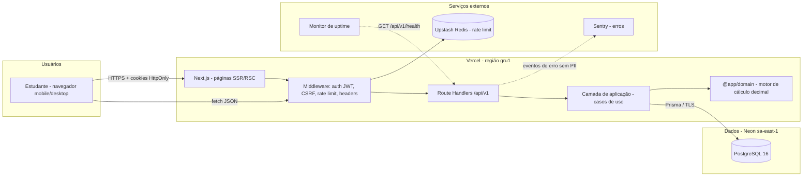
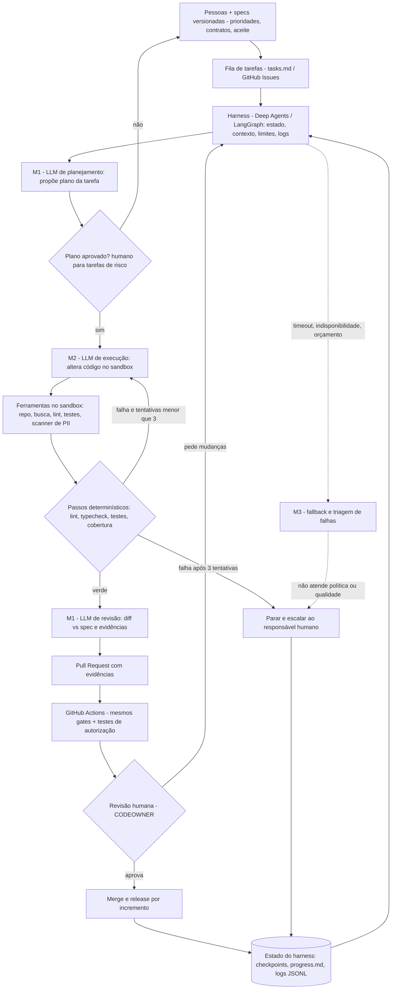
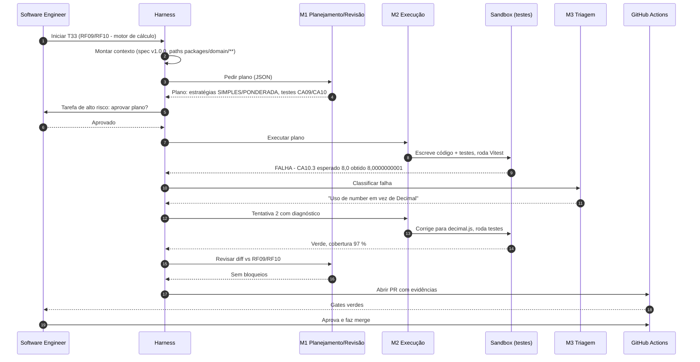

# Arquitetura e Stack

> **Versão:** 1.1.0 · **Data:** 25/11/2026 · Rastreável a [prd.md](./prd.md)
> **Equivalência Spec Kit:** `plan.md` · A constituição completa está em [constitution.md](./constitution.md), o contrato detalhado do harness em [harness-spec.md](./harness-spec.md) e os ADRs isolados em [adr/](./adr/).
> Os PDFs exigem **duas visões conectadas**: (A) a aplicação entregue e (B) a engenharia com IA (harness + múltiplas LLMs).

---

## 1. Constituição do projeto

Princípios **não negociáveis**. Qualquer mudança exige PR aprovado pelos 4 responsáveis.

| # | Princípio | Regra verificável |
|---|---|---|
| C1 | **Spec é a fonte da verdade** | Todo PR referencia `RFxx`/`Txx` e a versão da spec; mudança de comportamento sem atualizar a spec é bloqueada na revisão. |
| C2 | **Testes antes do merge** | Lint, typecheck, unitários, integração e testes de autorização verdes no CI; cobertura conforme RNF14/RNF15. |
| C3 | **Dados reais nunca saem do perímetro** | Agentes e LLMs só acessam código, specs e fixtures sintéticos (RN18). Segredos nunca entram no contexto de um agente. |
| C4 | **Humano aprova, humano responde** | Agentes abrem PRs; somente humanos (CODEOWNERS) aprovam merge e liberam release. |
| C5 | **Simplicidade primeiro** | Monólito modular; nenhum serviço/agente/fornecedor adicional sem ADR justificando o problema que resolve. |
| C6 | **Dono de release** | R0: AI Engineer · R1: FDE · R2: FDE (produto) + Platform (operação). Rollback pode ser acionado por Platform sem aprovação prévia. |
| C7 | **Rastreabilidade** | Cadeia RF → tarefa → PR → execução do agente → evidência de teste → release. |

---

## 2. Stack tecnológica

| Camada | Escolha | Justificativa (ligada ao escopo) |
|---|---|---|
| Linguagem | **TypeScript** (strict) ponta a ponta | Um só idioma para front, back e motor de cálculo; tipos compartilhados reduzem erros de contrato; boa performance de LLMs em TS |
| Front-end | **Next.js 15 (App Router) + React + Tailwind CSS + shadcn/ui** | SSR para LCP baixo (RNF03), componentes acessíveis (RNF16), mobile-first |
| API | **Next.js Route Handlers** em `/api/v1` (REST) | Monólito modular: um deploy, sem custo de orquestrar serviços; cabe em 160 h |
| Validação / contratos | **Zod** + geração de **OpenAPI 3.1** (`zod-to-openapi`) | Mesmo schema valida front, back e documenta a API (fonte para os agentes) |
| Motor de cálculo | Pacote puro `@app/domain` com **decimal.js** | Aritmética decimal exata (RN07); 100 % testável sem I/O |
| ORM / migrações | **Prisma** | Migrações versionadas, tipos gerados, transações |
| Banco de dados | **PostgreSQL 16** (Neon gerenciado) | Relacional (dados fortemente estruturados), constraints de integridade, PITR (RNF05), branches por ambiente |
| Autenticação | Implementação própria: **Argon2id** + JWT de acesso (15 min) + refresh opaco rotativo em cookie HttpOnly | Escopo simples (e-mail/senha); controle total de bloqueio e revogação (RF02) sem dependência paga |
| Rate limiting | **Upstash Redis** (`@upstash/ratelimit`) | Funciona em ambiente serverless (RNF10) |
| Hospedagem | **Vercel** (app) + **Neon** (DB), região mais próxima de São Paulo (`gru1` / `sa-east-1`) | Deploy por PR (preview), rollback instantâneo, baixa operação |
| Observabilidade | **Pino** (logs JSON) + **Sentry** (erros) + **Better Stack/UptimeRobot** (uptime) | RNF04, RNF19 |
| Testes | **Vitest** (unit/integração), **fast-check** (propriedades), **Playwright** (E2E), **axe-core**, **k6** | RNF01, RNF14, RNF16 |
| CI/CD | **GitHub Actions** + Vercel | Gates determinísticos para humanos e agentes |
| Monorepo | **pnpm + Turborepo** | Isola domínio/contratos/db; cache de build |
| Harness de IA | **LangChain Deep Agents (LangGraph)** estendido — ver ADR-001 | Multiprovedor, checkpoints, human-in-the-loop |

> [!NOTE]
> Alternativas descartadas: **NestJS + SPA separado** (dois deploys, mais horas de setup), **MongoDB** (integridade referencial e somas de pesos ficam mais frágeis), **Supabase Auth** (viável, mas acopla autorização a RLS e reduz controle de bloqueio/auditoria — reavaliar se L-07 exigir recuperação de senha).

---

## 3. Visão A — Aplicação entregue



### 3.1 Limites de acesso
| Fronteira | Controle |
|---|---|
| Internet → app | HTTPS/HSTS, CSP, rate limit, cookies `Secure`/`HttpOnly`/`SameSite=Lax`, CSRF double-submit |
| App → recurso | Middleware autentica; **cada caso de uso filtra por `usuario_id`** (RN01) — repositórios não expõem métodos sem `usuarioId` |
| App → banco | Usuário de aplicação sem privilégios DDL; migrações com usuário separado só no CI |
| App → externos | Nenhum dado acadêmico enviado; Sentry com `sendDefaultPii=false` e scrubbing |

### 3.2 Ambientes
| Ambiente | App | Banco | Dados | Acesso |
|---|---|---|---|---|
| `local` | `pnpm dev` / devcontainer | Postgres em Docker | Seeds sintéticos | Devs e agentes (sandbox) |
| `preview` | Deploy Vercel por PR | Branch Neon efêmero por PR | Seeds sintéticos | Equipe; agentes só leitura de logs do CI |
| `staging` | Branch `main` | Neon `staging` | Sintéticos + contas piloto de teste | Equipe |
| `production` | Tag de release `vX.Y.Z` | Neon `main` com PITR | **Dados reais** | Somente Platform (break-glass auditado); **agentes sem acesso** |

---

## 4. Visão B — Engenharia com IA (harness + múltiplas LLMs)



### 4.1 Passos determinísticos vs. LLM
| Passo | Tipo | Executor |
|---|---|---|
| Selecionar tarefa e montar contexto (spec + arquivos permitidos) | Determinístico | Script do harness |
| Planejar a tarefa | LLM | M1 |
| Editar código / testes | LLM | M2 |
| Lint, typecheck, testes, cobertura, scanner de PII/segredos, verificação de paths | Determinístico | Sandbox + CI |
| Revisar diff contra critérios de aceite | LLM (complementar) | M1 (modelo diferente do executor) |
| Classificar falha / resumir logs | LLM barato | M3 |
| Aprovar merge e liberar release | **Humano** | CODEOWNER / dono da release |

### 4.2 Contrato do harness (pseudoconfiguração)

```yaml
harness:
  framework: deepagents (LangGraph) — versão fixada em lockfile
  contexto_e_estado:
    spec_origem: docs/ (prd, architecture, data-model, api-spec, tasks) @ commit SHA + versão semântica no cabeçalho
    arquivos_fornecidos: lista explícita por tarefa (campo "paths_permitidos" em tasks.md)
    memoria_persistente: harness/state/progress.md (append-only) + harness/state/decisions.jsonl
    checkpoint: LangGraph checkpointer SQLite em harness/state/checkpoints.db, a cada nó concluído
    retomada: "harness resume --task Txx" retoma do último checkpoint; se o SHA base mudou → re-planejar
  ferramentas_e_acessos:
    planner (M1):   [read_repo, search_code, read_spec]                         # só leitura
    executor (M2):  [read_repo, search_code, write_file(paths_permitidos), run_tests, run_lint]
    reviewer (M1):  [read_diff, read_spec, read_test_report]                    # só leitura
    triage (M3):    [read_logs]
    sandbox: container Docker efêmero (devcontainer), sem rede exceto registry npm e APIs LLM via proxy
    segredos: nunca montados no sandbox; DB local efêmero; chaves LLM só no processo do orquestrador
    dados_pessoais: proibidos; scanner (regex CPF/e-mail/telefone + gitleaks) antes de cada chamada LLM e no PR
  execucao_e_falha:
    entrada: ID da tarefa + critérios de conclusão + paths_permitidos
    saida: branch agent/Txx-slug + PR com template de evidências
    paralelismo: até 2 tarefas simultâneas sem sobreposição de paths; dentro da tarefa, sequencial
    timeout: 10 min por chamada LLM; 30 min por tarefa
    max_tentativas: 3 ciclos executor→testes; 2 retries de rede com backoff exponencial (2s, 8s)
    limite_tokens: 1.5M entrada + 120k saída por tarefa (soma de todos os modelos)
    limite_gasto: US$ 8,00 por tarefa; US$ 90,00 por semana (alerta em 80 %)
    fallback: M2 indisponível > 15 min → M3 só para tarefas classificadas "baixo risco"; caso contrário pausar
    interrupcao: excedeu limite, violou política de dados ou alterou path proibido → parar + escalar
  verificacao_e_controle:
    testes: unit + integração + autorização (gates C2) e evals do harness (EV01..EV04)
    logs: harness/logs/Txx/<run_id>.jsonl (prompts sem segredos, tokens, custo, duração, resultado)
    criterios_de_parada: gates verdes + revisão M1 sem bloqueios → abrir PR; senão escalar
    aprovacao_humana: obrigatória para todo merge; obrigatória antes da execução para tarefas "alto risco" (auth, migrações, cálculo)
    rollback: revert do PR (git) + "Promote previous deployment" na Vercel + migração down/expand-contract
    responsavel_por_falhas: AI Engineer (harness) · Software Engineer (código) · Platform (CI/infra)
```

### 4.3 Política de múltiplas LLMs

> [!WARNING]
> Identificadores e preços abaixo são **hipóteses de planejamento** baseadas em catálogos públicos consultados historicamente. **Devem ser reconsultados e datados** nas páginas oficiais (OpenAI API, Claude API, Gemini API) antes da entrega (lacuna L-12).

| | **M1 — Planejamento e Revisão** | **M2 — Execução (código)** | **M3 — Fallback / triagem** |
|---|---|---|---|
| Provedor | OpenAI | Anthropic | Google |
| Identificador (fixar versão datada) | `gpt-5` (família de raciocínio) | `claude-sonnet-4-5` | `gemini-2.5-flash` |
| Finalidade | Decompor tarefa em plano; revisar diff vs. spec | Gerar/alterar código e testes com ferramentas | Resumir logs, classificar falhas, gerar fixtures sintéticos; fallback para tarefas de baixo risco |
| Gatilho | Início da tarefa; após gates verdes | Plano aprovado | Falha de gate (triagem); M2 indisponível |
| Contexto | Spec (trechos dos RFs), task, árvore de arquivos | Plano + paths permitidos + contratos Zod | Logs de CI/testes |
| Ferramentas | Somente leitura | Leitura/escrita restrita + testes | Somente leitura de logs |
| Formato de saída | JSON (schema do plano/revisão) | Diff + relatório | JSON (classificação) |
| Limites | 60k in / 6k out por chamada | 25k in / 2k out por chamada, 15 chamadas por ciclo | 10k in / 1k out |
| Preço (US$/1M tokens, hipótese) | 1,25 in / 10,00 out | 3,00 in / 15,00 out | 0,30 in / 2,50 out |
| Avaliação que sustenta a escolha | EV03 (qualidade do plano), taxa de bloqueios corretos na revisão | Taxa de tarefas que passam nos gates em ≤ 2 ciclos (meta ≥ 70 %) | Acurácia da triagem em 10 falhas rotuladas (meta ≥ 80 %) |
| Compatibilidade | `langchain-openai` (suportado no Deep Agents) | `langchain-anthropic` (suportado) | `langchain-google-genai` (suportado) |

**Regras da política:**
1. Revisor (M1) é sempre de provedor diferente do executor (M2) para reduzir erros correlacionados — mas **revisão por LLM não comprova correção**: gates determinísticos + humano decidem.
2. Fallback M3 só é usado se a tarefa for classificada de baixo risco **e** a política de dados for atendida; senão, **parar e escalar**.
3. Restrição de envio de dados a um fornecedor → remover o provedor do roteador e redistribuir (ver cenário E3 em tasks.md).

### 4.4 Simulação de uma tarefa (com falha)



Cenário alternativo: se a tentativa 3 falhar ou o custo passar de US$ 8,00, o harness grava checkpoint, registra `ESCALATED` em `decisions.jsonl` e notifica o responsável humano da tarefa.

---

## 5. Padrões de projeto

| Padrão | Onde | Por quê |
|---|---|---|
| **Monólito modular + camadas (Clean/Hexagonal-lite)** | `apps/web` → `application` → `domain` ← `infrastructure` | Separa regra de negócio de framework; agentes alteram módulos isolados |
| **Strategy** | `CalculoStrategy` (`SimplesStrategy`, `PonderadaStrategy`) | Absorve mudanças de regra de cálculo (ex.: exame final) sem tocar nos demais fluxos |
| **Funções puras / Functional Core, Imperative Shell** | `@app/domain` | Determinismo e testes de propriedade (RNF14) |
| **Repository** | `infrastructure/repositories/*` | Toda consulta exige `usuarioId` → RN01 aplicada por design |
| **Use Case / Application Service** | `application/use-cases/*` | Um caso de uso por operação; transação e auditoria centralizadas |
| **DTO + Schema validation** | `@app/contracts` (Zod) | Contrato único front/back/OpenAPI |
| **Result / erros de domínio tipados** | `DomainError` → mapeado para Problem Details (RFC 9457) | Erros previsíveis e documentados |
| **Optimistic Locking** | campo `versao` | RN16 |
| **Middleware chain** | auth → CSRF → rate limit → handler | Segurança transversal consistente |
| **Expand/Contract migrations** | Prisma | Rollback seguro de schema |

---

## 6. Estrutura de pastas do repositório

```text
/
├─ docs/                        # prd, architecture, data-model, api-spec, tasks (esta spec) + adr/
│  └─ adr/                      # ADR-001..003
├─ apps/
│  └─ web/                      # Next.js
│     ├─ app/
│     │  ├─ (auth)/login, cadastro
│     │  ├─ (app)/periodos/[id]/painel, disciplinas/[id]
│     │  └─ api/v1/             # Route Handlers (finos: parse → use case → resposta)
│     ├─ components/            # UI (shadcn/ui)
│     ├─ lib/                   # cliente HTTP, formatação pt-BR
│     └─ tests/e2e/             # Playwright
├─ packages/
│  ├─ domain/                   # motor de cálculo, status, nota necessária (puro, decimal.js)
│  ├─ application/              # casos de uso, portas (interfaces de repositório)
│  ├─ infrastructure/           # Prisma repos, auth (argon2, jwt), rate limit, logger
│  ├─ contracts/                # schemas Zod + gerador OpenAPI
│  └─ db/                       # schema.prisma, migrations, seeds sintéticos
├─ harness/
│  ├─ agents/                   # definições planner/executor/reviewer/triage
│  ├─ policies/                 # paths permitidos, limites, política de dados
│  ├─ prompts/                  # templates versionados
│  ├─ evals/                    # EV01..EV04 + fixtures sintéticos
│  ├─ state/                    # progress.md, decisions.jsonl, checkpoints.db (gitignored exceto progress)
│  └─ logs/                     # JSONL por execução (gitignored; artefato do CI)
├─ .github/
│  ├─ workflows/                # ci.yml, harness-evals.yml, release.yml
│  ├─ CODEOWNERS
│  └─ pull_request_template.md  # RF, Txx, versão da spec, evidências
├─ .devcontainer/               # sandbox padrão para humanos e agentes
└─ turbo.json, pnpm-workspace.yaml
```

---

## 7. Fluxo de requisição (exemplo: lançar nota)

1. `PUT /api/v1/avaliacoes/{id}/nota` → middleware valida JWT, CSRF e rate limit.
2. Handler valida payload com Zod (`LancarNotaSchema`).
3. `LancarNotaUseCase` abre transação: busca avaliação por `id` **e** `usuarioId` (404 se não for dono) → valida `versao` → grava nota → grava `historico_nota`.
4. `@app/domain.calcularDesempenho()` recalcula a disciplina (não persistido; calculado na leitura).
5. Resposta 200 com avaliação + desempenho atualizado.

---

## 8. Estratégia de verificação

| Nível | Ferramenta | Gate |
|---|---|---|
| Unitário (domínio) | Vitest + fast-check | Cobertura ≥ 95 % `packages/domain` |
| Integração (API + DB) | Vitest + Postgres efêmero | Todos os CAs de RF01–RF15 automatizáveis |
| Autorização / isolamento | Suíte IDOR (2 usuários sintéticos, todos os endpoints) | 0 falhas — **bloqueia release** |
| E2E | Playwright (fluxo crítico: cadastro → disciplina → nota → painel) | Verde em Chromium + WebKit |
| Acessibilidade | axe-core no Playwright | 0 violações sérias/críticas |
| Performance | k6 em staging | RNF01/RNF02 |
| Segurança | `pnpm audit`, gitleaks, cabeçalhos | 0 críticas/altas |
| Harness | Evals EV01–EV04 | Ver tasks.md §5 |

---

## 9. Riscos técnicos

| Risco | Prob. | Impacto | Mitigação |
|---|---|---|---|
| Erro de cálculo por ponto flutuante | Média | Alto | decimal.js + testes de propriedade |
| IDOR (acesso a dados de outro estudante) | Média | Crítico | Repositórios exigem `usuarioId`; suíte IDOR bloqueante |
| Harness consome mais horas que o previsto | Alta | Alto | Adotar framework existente (ADR-001); harness mínimo em R0; fallback para uso manual dos agentes |
| Indisponibilidade de provedor LLM | Média | Médio | M3 fallback para baixo risco; desenvolvimento humano segue |
| Estouro de gasto com tokens | Média | Médio | Limites por tarefa/semana; alerta 80 %; sensibilidade +50 % orçada |
| Agente altera arquivo fora do escopo | Média | Alto | `paths_permitidos` verificado no harness e no CI |

---

## 10. ADRs

### ADR-001 — Harness: adotar e estender Deep Agents (LangGraph)
- **Contexto:** precisamos de orquestração com múltiplos provedores, estado persistente, checkpoints e intervenção humana, com só ~40 h do AI Engineer.
- **Alternativas:** (a) construir orquestrador próprio — controle total, mas custo alto e risco no prazo; (b) usar um agente de código fechado de um único fornecedor (ex.: CLI de um provedor) — rápido, mas restringe modelos e dificulta política multi-LLM; (c) **Deep Agents/LangGraph** — open source, integrações oficiais com OpenAI/Anthropic/Google, checkpointer, subagentes, `interrupt` para humano.
- **Decisão:** (c), estendido com políticas próprias (paths, scanner de PII, limites de custo) e passos determinísticos fora da LLM (sandbox + GitHub Actions).
- **Consequências:** dependência de biblioteca em evolução (fixar versão); equipe precisa de Python/TS do LangGraph; um arquivo de instruções isolado **não** substitui a orquestração — as políticas são código.

### ADR-002 — Modelos: três LLMs com papéis distintos
- **Contexto:** a Parte 2 exige ≥ 3 modelos distintos, ≥ 2 ativos; custo e qualidade variam por tarefa.
- **Alternativas:** (a) um modelo para tudo — simples, mas revisão correlacionada e sem fallback; (b) três modelos de um mesmo provedor — menos integrações, mas indisponibilidade derruba tudo; (c) **três provedores** com papéis (M1 plano/revisão, M2 execução, M3 fallback/triagem).
- **Decisão:** (c). M2 concentra ~90 % dos tokens; M1 é usado em poucas chamadas grandes; M3 é barato.
- **Consequências:** três contratos/chaves e políticas de dados a validar; se um fornecedor for vetado (evento E3), o roteador remove-o e a política define substituto ou parada.

### ADR-003 — Operação: monólito serverless (Vercel + Neon) com releases por tag
- **Contexto:** 4 semanas, 160 h, sem equipe de operação dedicada em tempo integral.
- **Alternativas:** (a) VM/containers em nuvem (mais controle, mais horas de operação); (b) Kubernetes (excessivo); (c) **PaaS serverless** com previews por PR.
- **Decisão:** (c). Releases por tag `vX.Y.Z`; rollback via "promote previous deployment" + migrações expand/contract; PITR no banco.
- **Consequências:** cold starts possíveis (mitigar com região próxima e funções leves); custo cresce com uso, monitorado mensalmente; lock-in moderado (Next.js é portátil).
