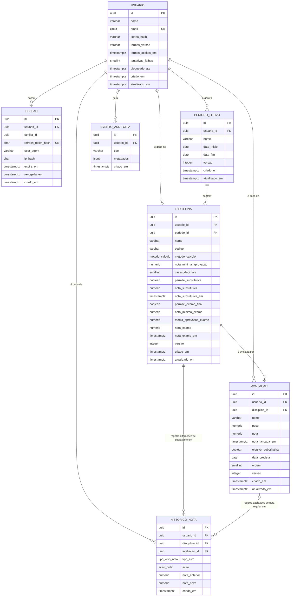

# Modelagem de Dados

> **Versão:** 1.1.0 · **Data:** 25/11/2026 · SGBD: **PostgreSQL 16** · ORM: Prisma
> Rastreável a [prd.md](./prd.md) (RN01–RN21) e [api-spec.md](./api-spec.md).

## 1. Decisões de modelagem

| # | Decisão | Justificativa |
|---|---|---|
| DM1 | **Médias, situação e nota necessária NÃO são persistidas**; são calculadas na leitura pelo `@app/domain` | Evita inconsistência após mudança de pesos/método (RN12); volume máximo (15 × 20 avaliações) é trivial para calcular (RNF01) |
| DM2 | `usuario_id` **desnormalizado** em `disciplina` e `avaliacao` | Toda consulta filtra por dono em um único índice (RN01); FKs compostas garantem que o dono é o mesmo da entidade-pai |
| DM3 | Nota regular armazenada na própria `avaliacao` (`nota` nulo = pendente); notas de **Prova Substitutiva** (`nota_substitutiva`) e **Exame Final** (`nota_exame`) armazenadas diretamente na `disciplina` | Cada disciplina tem no máximo 1 substitutiva e 1 exame final; `NULL` expressa RN05 (pendente ≠ zero) |
| DM4 | Tipos `NUMERIC` para notas e pesos | Precisão decimal exata (RN07) |
| DM5 | Chaves `UUID` (`gen_random_uuid()`) | Não enumeráveis; seguros em URLs |
| DM6 | `ON DELETE CASCADE` a partir de `usuario` | Exclusão definitiva LGPD (RN17) em uma operação |
| DM7 | Coluna `versao INTEGER` em entidades editáveis | Controle otimista (RN16) |
| DM8 | Nomenclatura `snake_case` em pt-BR; timestamps `TIMESTAMPTZ` em UTC | Consistência; conversão para `America/Sao_Paulo` só na interface |

## 2. Diagrama Entidade-Relacionamento

## 3. Tipos enumerados

| Enum | Valores | Uso |
|---|---|---|
| `metodo_calculo` | `SIMPLES`, `PONDERADA` | `disciplina.metodo_calculo` (RN06) |
| `acao_nota` | `LANCADA`, `ALTERADA`, `REMOVIDA` | `historico_nota.acao` (RN11) |
| `tipo_alvo_nota` | `REGULAR`, `SUBSTITUTIVA`, `EXAME_FINAL` | `historico_nota.tipo_alvo` (RN11, RN19–RN21) |

> A situação da disciplina (`SituacaoDisciplina`) é um enum **de domínio** (TypeScript), não do banco, pois é calculada (DM1).

## 4. Dicionário de dados

Convenções: **PK** chave primária · **FK** chave estrangeira · **UK** única · **NN** não nulo · `now()` = `CURRENT_TIMESTAMP`.

### 4.1 `usuario`
| Campo | Tipo | Restrições | Padrão | Descrição |
|---|---|---|---|---|
| `id` | `UUID` | PK, NN | `gen_random_uuid()` | Identificador |
| `nome` | `VARCHAR(120)` | NN, `CHECK (length(trim(nome)) BETWEEN 2 AND 120)` | — | Nome de exibição |
| `email` | `CITEXT` | NN, UK | — | Login; case-insensitive (extensão `citext`) |
| `senha_hash` | `VARCHAR(255)` | NN | — | Hash Argon2id (formato PHC) |
| `termos_versao` | `VARCHAR(20)` | NN | — | Versão dos termos aceitos (ex.: `2026-11`) |
| `termos_aceitos_em` | `TIMESTAMPTZ` | NN | `now()` | Prova do consentimento |
| `tentativas_falhas` | `SMALLINT` | NN, `CHECK (>= 0)` | `0` | Contador para bloqueio (RF02) |
| `bloqueado_ate` | `TIMESTAMPTZ` | — | `NULL` | Fim do bloqueio temporário |
| `criado_em` | `TIMESTAMPTZ` | NN | `now()` | — |
| `atualizado_em` | `TIMESTAMPTZ` | NN | `now()` | Atualizado pelo ORM |

**Índices:** `usuario_pkey (id)`, `usuario_email_key UNIQUE (email)`.

### 4.2 `sessao`
| Campo | Tipo | Restrições | Padrão | Descrição |
|---|---|---|---|---|
| `id` | `UUID` | PK | `gen_random_uuid()` | — |
| `usuario_id` | `UUID` | FK → `usuario.id` **ON DELETE CASCADE**, NN | — | Dono |
| `familia_id` | `UUID` | NN | — | Agrupa rotações; reuso revoga a família (CA02.4) |
| `refresh_token_hash` | `CHAR(64)` | NN, UK | — | SHA-256 do token opaco (o token em claro nunca é salvo) |
| `user_agent` | `VARCHAR(255)` | — | — | Exibição de sessões |
| `ip_hash` | `CHAR(64)` | — | — | SHA-256 com salt do IP (minimização LGPD) |
| `expira_em` | `TIMESTAMPTZ` | NN | — | `criado_em + 7 dias` |
| `revogada_em` | `TIMESTAMPTZ` | — | `NULL` | Logout / reuso / exclusão |
| `criado_em` | `TIMESTAMPTZ` | NN | `now()` | — |

**Índices:** `UNIQUE (refresh_token_hash)`, `(usuario_id)`, `(familia_id)`, `(expira_em)` para job de limpeza diária.

### 4.3 `periodo_letivo`
| Campo | Tipo | Restrições | Padrão | Descrição |
|---|---|---|---|---|
| `id` | `UUID` | PK | `gen_random_uuid()` | — |
| `usuario_id` | `UUID` | FK → `usuario.id` ON DELETE CASCADE, NN | — | Dono |
| `nome` | `VARCHAR(40)` | NN, `CHECK (length(trim(nome)) >= 1)` | — | Ex.: `2026.2` |
| `data_inicio` | `DATE` | — | `NULL` | — |
| `data_fim` | `DATE` | `CHECK (data_fim IS NULL OR data_inicio IS NULL OR data_fim >= data_inicio)` | `NULL` | CA04.3 |
| `versao` | `INTEGER` | NN | `1` | RN16 |
| `criado_em` / `atualizado_em` | `TIMESTAMPTZ` | NN | `now()` | — |

**Índices / restrições:**
- `UNIQUE (usuario_id, lower(nome))` — RN15.
- `UNIQUE (id, usuario_id)` — alvo das FKs compostas (DM2).
- `(usuario_id, criado_em DESC)` — listagem.

### 4.4 `disciplina`
| Campo | Tipo | Restrições | Padrão | Descrição |
|---|---|---|---|---|
| `id` | `UUID` | PK | `gen_random_uuid()` | — |
| `usuario_id` | `UUID` | NN | — | Dono (DM2) |
| `periodo_id` | `UUID` | NN | — | Período |
| `nome` | `VARCHAR(120)` | NN, `CHECK (length(trim(nome)) >= 1)` | — | — |
| `codigo` | `VARCHAR(20)` | — | `NULL` | Ex.: `MAT101` |
| `metodo_calculo` | `metodo_calculo` | NN | `'PONDERADA'` | RN06 |
| `nota_minima_aprovacao` | `NUMERIC(4,2)` | NN, `CHECK (BETWEEN 0 AND 10)` | `6.00` | RN08 |
| `casas_decimais` | `SMALLINT` | NN, `CHECK (IN (0,1,2))` | `1` | RN07 |
| `permite_substitutiva` | `BOOLEAN` | NN | `true` | RN19 |
| `nota_substitutiva` | `NUMERIC(4,2)` | `CHECK (IS NULL OR BETWEEN 0 AND 10)` | `NULL` | Nota da substitutiva (RN19) |
| `nota_substitutiva_em` | `TIMESTAMPTZ` | `CHECK ((nota_substitutiva IS NULL) = (nota_substitutiva_em IS NULL))` | `NULL` | Coerência nota/data |
| `permite_exame_final` | `BOOLEAN` | NN | `true` | RN20 |
| `nota_minima_exame` | `NUMERIC(4,2)` | NN, `CHECK (BETWEEN 0 AND nota_minima_aprovacao)` | `4.00` | Mínimo para direito ao exame (RN20) |
| `media_aprovacao_exame` | `NUMERIC(4,2)` | NN, `CHECK (BETWEEN 0 AND 10)` | `5.00` | Média pós-exame exigida (RN21) |
| `nota_exame` | `NUMERIC(4,2)` | `CHECK (IS NULL OR BETWEEN 0 AND 10)` | `NULL` | Nota do exame final (RN21) |
| `nota_exame_em` | `TIMESTAMPTZ` | `CHECK ((nota_exame IS NULL) = (nota_exame_em IS NULL))` | `NULL` | Coerência nota/data |
| `versao` | `INTEGER` | NN | `1` | RN16 |
| `criado_em` / `atualizado_em` | `TIMESTAMPTZ` | NN | `now()` | — |

**Chaves / índices:**
- `FOREIGN KEY (periodo_id, usuario_id) REFERENCES periodo_letivo (id, usuario_id) ON DELETE CASCADE` — garante mesmo dono.
- `FOREIGN KEY (usuario_id) REFERENCES usuario (id) ON DELETE CASCADE`.
- `UNIQUE (periodo_id, lower(nome))` — RN15.
- `UNIQUE (id, usuario_id)` — alvo de FK composta.
- `(usuario_id, periodo_id)` — painel.

### 4.5 `avaliacao`
| Campo | Tipo | Restrições | Padrão | Descrição |
|---|---|---|---|---|
| `id` | `UUID` | PK | `gen_random_uuid()` | — |
| `usuario_id` | `UUID` | NN | — | Dono (DM2) |
| `disciplina_id` | `UUID` | NN | — | — |
| `nome` | `VARCHAR(80)` | NN, `CHECK (length(trim(nome)) >= 1)` | — | Ex.: `P1` |
| `peso` | `NUMERIC(5,2)` | NN, `CHECK (peso > 0 AND peso <= 100)` | — | % (RN03). Ignorado no cálculo se `SIMPLES` |
| `nota` | `NUMERIC(4,2)` | `CHECK (nota IS NULL OR nota BETWEEN 0 AND 10)` | `NULL` | `NULL` = pendente (RN05) |
| `nota_lancada_em` | `TIMESTAMPTZ` | `CHECK ((nota IS NULL) = (nota_lancada_em IS NULL))` | `NULL` | Coerência nota/data |
| `elegivel_substitutiva` | `BOOLEAN` | NN | `true` | Permite ser substituída pela Prova Substitutiva (RN19) |
| `data_prevista` | `DATE` | — | `NULL` | Usado em "próximas avaliações" (RF14) |
| `ordem` | `SMALLINT` | NN, `CHECK (ordem >= 0)` | `0` | Ordenação na UI |
| `versao` | `INTEGER` | NN | `1` | RN16 |
| `criado_em` / `atualizado_em` | `TIMESTAMPTZ` | NN | `now()` | — |

**Chaves / índices:**
- `FOREIGN KEY (disciplina_id, usuario_id) REFERENCES disciplina (id, usuario_id) ON DELETE CASCADE`.
- `FOREIGN KEY (usuario_id) REFERENCES usuario (id) ON DELETE CASCADE`.
- `UNIQUE (disciplina_id, lower(nome))` — RN15.
- `(disciplina_id, ordem)` — listagem.
- `(usuario_id, data_prevista) WHERE nota IS NULL` — índice parcial para próximas avaliações.

**Integridade da soma de pesos (RN03):** validada no caso de uso dentro de transação com `SELECT ... FROM disciplina WHERE id = $1 FOR UPDATE` (serializa escritas concorrentes na mesma disciplina) e reforçada por **constraint trigger** `DEFERRABLE INITIALLY DEFERRED` que rejeita `SUM(peso) > 100` por `disciplina_id` ao final da transação.

### 4.6 `historico_nota` (append-only)
| Campo | Tipo | Restrições | Padrão | Descrição |
|---|---|---|---|---|
| `id` | `UUID` | PK | `gen_random_uuid()` | — |
| `usuario_id` | `UUID` | FK → `usuario.id` ON DELETE CASCADE, NN | — | Dono |
| `disciplina_id` | `UUID` | FK → `disciplina.id` ON DELETE CASCADE, NN | — | Disciplina afetada |
| `avaliacao_id` | `UUID` | FK → `avaliacao.id` ON DELETE CASCADE, `CHECK ((tipo_alvo = 'REGULAR') = (avaliacao_id IS NOT NULL))` | `NULL` | Presente apenas quando `tipo_alvo = 'REGULAR'` |
| `tipo_alvo` | `tipo_alvo_nota` | NN | `'REGULAR'` | `REGULAR`, `SUBSTITUTIVA` ou `EXAME_FINAL` |
| `acao` | `acao_nota` | NN | — | RN11 |
| `nota_anterior` | `NUMERIC(4,2)` | `CHECK (acao <> 'LANCADA' OR nota_anterior IS NULL)` | — | — |
| `nota_nova` | `NUMERIC(4,2)` | `CHECK (acao <> 'REMOVIDA' OR nota_nova IS NULL)` | — | — |
| `criado_em` | `TIMESTAMPTZ` | NN | `now()` | — |

**Índices:** `(disciplina_id, criado_em DESC)` e `(avaliacao_id, criado_em DESC)`.
**Imutabilidade:** usuário de aplicação recebe somente `INSERT, SELECT` nesta tabela (sem `UPDATE`/`DELETE`; exclusões só via cascade disparado pelo dono do schema). Excluir uma avaliação apaga seu histórico (decisão: o histórico pertence à avaliação; a remoção da avaliação é registrada em `evento_auditoria`).

### 4.7 `evento_auditoria`
| Campo | Tipo | Restrições | Padrão | Descrição |
|---|---|---|---|---|
| `id` | `UUID` | PK | `gen_random_uuid()` | — |
| `usuario_id` | `UUID` | FK → `usuario.id` **ON DELETE SET NULL** | — | Anulado na exclusão da conta (L-09) |
| `tipo` | `VARCHAR(60)` | NN | — | Ver catálogo abaixo |
| `metadados` | `JSONB` | NN, **sem PII** | `'{}'` | IDs de recursos, valores antes/depois de configuração, `traceId` |
| `criado_em` | `TIMESTAMPTZ` | NN | `now()` | — |

**Catálogo de `tipo`:** `CONTA_CRIADA`, `LOGIN_SUCESSO`, `LOGIN_FALHA`, `CONTA_BLOQUEADA`, `REFRESH_REUSO_DETECTADO`, `LOGOUT`, `DADOS_EXPORTADOS`, `CONTA_EXCLUIDA`, `DISCIPLINA_CRITERIO_ALTERADO`, `AVALIACAO_EXCLUIDA`, `PERIODO_EXCLUIDO`.
**Índices:** `(usuario_id, criado_em DESC)`, `(tipo, criado_em DESC)`.
**Retenção:** 180 dias (job diário apaga registros mais antigos).

## 5. Regras de integridade (resumo)

| Regra | Mecanismo |
|---|---|
| RN01 isolamento | `usuario_id` em todas as tabelas de domínio + FKs compostas + repositórios exigindo `usuarioId` |
| RN02 escala de notas | `CHECK nota BETWEEN 0 AND 10`, `NUMERIC(4,2)` |
| RN03 pesos | `CHECK` por linha + constraint trigger de soma + lock pessimista na disciplina |
| RN05 pendente ≠ zero | `nota NULL` + `CHECK` de coerência com `nota_lancada_em` |
| RN11 histórico imutável | Permissões `INSERT/SELECT` + inserção na mesma transação da nota |
| RN14 limites | Validado no caso de uso (`COUNT` dentro da transação) |
| RN15 nomes únicos | Índices `UNIQUE` sobre `lower(nome)` |
| RN16 concorrência | `UPDATE ... WHERE id = $1 AND versao = $2` → 0 linhas = conflito (409) |
| RN17 exclusão LGPD | Cascade a partir de `usuario`; `evento_auditoria.usuario_id` → `NULL` |

## 6. Volumetria e performance

| Tabela | Linhas por estudante (máx. RN14) | 5.000 estudantes (estimativa realista: 2 períodos × 6 disc. × 4 aval.) |
|---|---|---|
| `periodo_letivo` | 20 | ~10 mil |
| `disciplina` | 300 | ~60 mil |
| `avaliacao` | 6.000 | ~240 mil |
| `historico_nota` | variável | ~500 mil/ano |

O painel (RF14) executa **2 consultas indexadas** (disciplinas do período + avaliações dessas disciplinas) e calcula em memória — compatível com RNF01.

## 7. Migrações, seeds e backup
- Migrações Prisma versionadas em `packages/db/migrations`; aplicadas **somente pelo CI** (`prisma migrate deploy`) com usuário de migração.
- Mudanças destrutivas seguem **expand/contract** (adicionar → migrar dados → remover em release posterior) para permitir rollback de aplicação.
- Seeds: apenas dados **sintéticos** (`@example.test`), usados em local/preview/staging e pelos agentes.
- Backup: Neon PITR 7 dias (produção); teste de restauração antes do R2 (RNF05).
