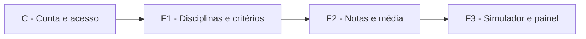

# PRD: Plataforma de Apoio ao Estudante Universitário

> **Versão da spec:** 1.1.0 · **Data:** 25/11/2026 · **Status:** Aprovado para Implementação (Baseline SDD)
> **Fontes:** `Trabalho_SDD_Custos_Plataforma_Estudantil.pdf` (Parte 1) e `Parte_2_SDD_Harness_Arquitetura_IA.pdf` (Parte 2).
> **Equivalência Spec Kit:** este documento corresponde ao `spec.md`; os princípios inegociáveis estão em [constitution.md](./constitution.md).

> [!IMPORTANT]
> **Premissa crítica (P-01):** os PDFs pedem para "retomar o backlog do trabalho anterior", mas esse backlog **não está nos anexos**. O recorte abaixo foi **inferido** a partir do único exemplo dado no PDF (*"R01 – Implementar média ponderada"*, *"Testar arredondamento e notas ausentes"*, *"média simples → pesos diferentes"*). Se o backlog real for outro, este PRD precisa ser revisado antes de seguir. Ver [Lacunas](#9-lacunas-ambiguidades-e-decisões-pendentes).

---

## 1. Visão geral

### 1.1 Problema
Estudantes universitários acompanham suas notas em planilhas, anotações ou de cabeça. Cada disciplina tem critérios próprios (pesos, quantidade de avaliações, nota mínima), o que gera:
- dúvida constante sobre a **média atual** e a **situação real** (aprovado, em risco, reprovado);
- erros de cálculo com **pesos diferentes**, **arredondamento** e **avaliações ainda não realizadas**;
- descoberta tardia de que é preciso uma nota alta (ou impossível) na última avaliação.

### 1.2 Proposta de valor
Uma aplicação web responsiva onde o próprio estudante cadastra suas disciplinas e critérios de avaliação, lança as notas e obtém em tempo real: média parcial/final, situação na disciplina e **quanto precisa tirar** nas avaliações restantes.

### 1.3 Público-alvo e personas
| Persona | Descrição | Necessidade principal |
|---|---|---|
| **Estudante de graduação** (usuário primário) | 17–30 anos, usa majoritariamente celular, 4–8 disciplinas por semestre | Saber rapidamente sua situação e onde concentrar esforço |
| **Estudante piloto** (R1) | Grupo de 5–15 estudantes voluntários | Usar a 1ª versão e dar feedback estruturado |
| **Faculdade / coordenação** (stakeholder) | Patrocinadora; valida aceite e adoção (via FDE) | Ferramenta útil, segura e aderente às regras acadêmicas |
| **Equipe de engenharia + agentes de IA** (stakeholder interno) | 4 pessoas + harness com 3 LLMs | Spec precisa, testável e rastreável |

### 1.4 Recorte da entrega (3 funcionalidades)
| ID | Funcionalidade | Valor para o estudante | Por que na mesma entrega |
|---|---|---|---|
| **F1** | Gestão de Disciplinas e Critérios de Avaliação | Modela as regras de cada disciplina uma única vez | Pré-requisito de dados para F2 e F3 |
| **F2** | Lançamento de Notas e Cálculo de Média | Elimina erros de cálculo (pesos, arredondamento, ausentes) | Consome F1; produz o insumo de F3 |
| **F3** | Simulador de Nota Necessária e Painel de Situação | Antecipa riscos e orienta onde estudar | Só tem valor com F1+F2; fecha o ciclo "registrar → entender → agir" |

**Pré-requisito transversal (C):** Conta e acesso (cadastro, login, LGPD). Não conta como funcionalidade do recorte, mas é dependência técnica obrigatória para isolar os dados de cada estudante.

---

## 2. Glossário
| Termo | Definição |
|---|---|
| **Período letivo** | Agrupador de disciplinas (ex.: `2026.2`). |
| **Avaliação** | Item avaliativo de uma disciplina (prova, trabalho, lista) com **peso** em %. |
| **Peso** | Percentual da avaliação na média; a soma dos pesos de uma disciplina deve ser **100** para a configuração estar completa. |
| **Método de cálculo** | `SIMPLES` (média aritmética, pesos ignorados) ou `PONDERADA` (usa pesos). |
| **Nota lançada / pendente** | Avaliação com nota registrada / ainda sem nota (não é zero). |
| **Pontos acumulados** | Σ(nota × peso) / 100 das avaliações lançadas — o mínimo garantido da média final. |
| **Média parcial** | Média considerando apenas as avaliações lançadas (desempenho atual). |
| **Média final** | Média com todas as avaliações regulares lançadas (após eventual aplicação da Prova Substitutiva). |
| **Nota necessária** | Nota uniforme mínima nas avaliações pendentes (ou na Substitutiva/Exame Final) para atingir a nota-alvo. |
| **Prova Substitutiva** | Avaliação opcional da disciplina que substitui automaticamente a **menor nota** entre as avaliações regulares elegíveis (`permiteSubstitutiva = true`), somente se `notaSubstitutiva > menorNota`. |
| **Exame Final** | Avaliação de recuperação pós-média para estudantes cuja média final regular ficou na faixa de exame (`notaMinimaExame <= mediaRegular < notaMinimaAprovacao`, padrão `4,0` a `5,9`). |
| **Média pós-exame** | `(mediaRegular + notaExame) / 2`, exigindo valor `>= mediaAprovacaoExame` (padrão `5,0`) para aprovação. |

---

## 3. Regras de negócio (RN)

| ID | Regra |
|---|---|
| **RN01** | Todo dado acadêmico pertence a exatamente um estudante. Um estudante **nunca** lê ou altera dados de outro (inclusive via ID adivinhado). |
| **RN02** | Notas usam escala **0,00 a 10,00**, com no máximo 2 casas decimais. |
| **RN03** | Peso de avaliação: > 0 e ≤ 100, até 2 casas decimais. A soma dos pesos de uma disciplina **não pode ultrapassar 100**. |
| **RN04** | A média só é considerada **válida** quando a configuração está completa: método `PONDERADA` com soma de pesos = 100, ou método `SIMPLES` com ≥ 1 avaliação. Caso contrário a disciplina fica em `CONFIGURACAO_INCOMPLETA`. |
| **RN05** | Avaliação **pendente** (sem nota) **não é zero**. Ela não entra na média parcial e é tratada como "a definir" no simulador. |
| **RN06** | Fórmulas (método `PONDERADA`): `pontosAcumulados = Σ(nota_i × peso_i) / 100` (lançadas); `mediaParcial = Σ(nota_i × peso_i) / Σ(peso_i lançadas)`; `mediaFinal = Σ(nota_i × peso_i) / 100` (todas lançadas). No método `SIMPLES`, todos os pesos são considerados iguais (`100 / n`). |
| **RN07** | Cálculos usam aritmética **decimal exata** (sem ponto flutuante binário). O arredondamento ocorre **somente no resultado exibido**, com `HALF_UP` para `casasDecimais` da disciplina (padrão **1**; permitido 0, 1 ou 2). |
| **RN08** | Nota mínima de aprovação é configurável por disciplina (0–10), padrão **6,0** *(premissa — confirmar com a faculdade)*. |
| **RN09** | Situação da disciplina (ver RF15): `CONFIGURACAO_INCOMPLETA`, `SEM_NOTAS`, `EM_ANDAMENTO`, `EM_RISCO`, `APROVACAO_GARANTIDA`, `REPROVACAO_INEVITAVEL`, `AGUARDANDO_SUBSTITUTIVA`, `EM_EXAME_FINAL`, `APROVADO`, `APROVADO_POS_EXAME`, `REPROVADO`, `REPROVADO_POS_EXAME`. |
| **RN10** | Nota necessária: `x = (alvo × 100 − Σ(nota_i × peso_i lançadas)) / Σ(peso_i pendentes)`, arredondada **para cima** (`CEILING`) nas casas da disciplina (resultado conservador). Se `x ≤ 0` → "já atingido"; se `x > 10` → "inviável". Quando a disciplina está `EM_EXAME_FINAL`, a nota necessária no exame é `x_exame = (2 × mediaAprovacaoExame) − mediaRegular`. |
| **RN11** | Toda criação, alteração ou remoção de nota (regular, substitutiva ou exame final) gera um registro imutável de histórico (valor anterior, novo valor, data/hora). |
| **RN12** | Alterar método de cálculo, pesos, nota mínima ou regras de substitutiva/exame de uma disciplina com notas lançadas exige confirmação explícita e recalcula tudo; a mudança é auditada. |
| **RN13** | Simulações ("e se") **nunca** persistem notas. |
| **RN14** | Limites por estudante (anti-abuso): até 20 períodos, 15 disciplinas por período, 20 avaliações regulares por disciplina *(premissa)*. |
| **RN15** | Nomes únicos (case-insensitive): período por estudante; disciplina por período; avaliação por disciplina. |
| **RN16** | Edições concorrentes do mesmo recurso usam controle otimista por `versao`; a segunda gravação conflitante é rejeitada. |
| **RN17** | Exclusão de conta remove **definitivamente** todos os dados acadêmicos do estudante (LGPD, direito de eliminação). |
| **RN18 (engenharia)** | Nenhum dado pessoal ou acadêmico real é enviado a LLMs. Agentes trabalham somente com código e dados sintéticos. |
| **RN19 (Substitutiva)** | Quando `permiteSubstitutiva = true` na disciplina e todas as avaliações regulares estão lançadas, se `notaSubstitutiva` for informada, o motor identifica a avaliação elegível (`elegivelSubstitutiva = true`) cujo reemplazo maximiza a média (em pesos iguais, a menor nota; em pesos distintos, o maior ganho `+(notaSub - nota_i) × peso_i`). Se o ganho for `<= 0`, a nota original é mantida (a substitutiva nunca prejudica o estudante). |
| **RN20 (Exame Final)** | Quando `permiteExameFinal = true` (padrão `true`), após fechadas as avaliações regulares (e aplicada a substitutiva, se houver): se `mediaRegular >= notaMinimaAprovacao` (padrão `6,0`) → `APROVADO`; se `mediaRegular < notaMinimaExame` (padrão `4,0`) → `REPROVADO` direto; se `notaMinimaExame <= mediaRegular < notaMinimaAprovacao` → estudante entra em `EM_EXAME_FINAL`. |
| **RN21 (Média Pós-Exame)** | Com `notaExame` lançada em disciplina `EM_EXAME_FINAL`, calcula-se `mediaPosExame = (mediaRegular + notaExame) / 2` (arredondada `HALF_UP` nas casas da disciplina). Se `mediaPosExame >= mediaAprovacaoExame` (padrão `5,0`) → `APROVADO_POS_EXAME`; caso contrário → `REPROVADO_POS_EXAME`. |

---

## 4. Requisitos Funcionais

> Formato: cada RF tem descrição, regras aplicáveis, ≥ 3 critérios de aceite (*Given/When/Then*) e exceções. IDs são usados para rastreabilidade em [api-spec.md](./api-spec.md) e [tasks.md](./tasks.md).

### 4.1 Pré-requisito C — Conta e acesso

#### RF01 — Cadastro de estudante
O visitante cria conta com nome, e-mail, senha e aceite dos termos de uso/política de privacidade.
- **Regras:** e-mail único (case-insensitive); senha ≥ 10 caracteres, contendo letras e números, e não presente em lista de senhas comuns; aceite obrigatório registra a versão dos termos.

| # | Critério de aceite |
|---|---|
| CA01.1 | **Given** um visitante com e-mail não cadastrado **When** envia nome, e-mail válido, senha forte e aceite dos termos **Then** a conta é criada, uma sessão é iniciada e ele é direcionado ao painel vazio. |
| CA01.2 | **Given** um e-mail já cadastrado (em qualquer combinação de maiúsculas/minúsculas) **When** o visitante tenta se cadastrar com ele **Then** o sistema responde com erro genérico de cadastro sem confirmar a existência da conta. |
| CA01.3 | **Given** uma senha com menos de 10 caracteres ou presente na lista de senhas comuns **When** o visitante envia o formulário **Then** o cadastro é recusado com mensagem indicando o critério não atendido. |
| CA01.4 | **Given** o aceite dos termos desmarcado **When** o visitante envia o formulário **Then** o cadastro é recusado. |

- **Exceções:** campos ausentes/maiores que o limite → erro de validação por campo; falha do banco → erro genérico e nenhum dado parcial persistido.

#### RF02 — Autenticação e sessão
Login com e-mail/senha, manutenção da sessão, renovação transparente e logout.
- **Regras:** sessão de acesso curta (15 min) renovada por token de refresh rotativo (7 dias); após 5 falhas consecutivas em 15 min a conta fica bloqueada por 15 min; logout revoga a sessão.

| # | Critério de aceite |
|---|---|
| CA02.1 | **Given** credenciais válidas **When** o estudante faz login **Then** a sessão é criada e ele acessa o painel. |
| CA02.2 | **Given** 5 tentativas com senha incorreta em 15 min **When** ocorre a 6ª tentativa (mesmo com senha correta) **Then** o login é recusado com mensagem de bloqueio temporário e o evento é auditado. |
| CA02.3 | **Given** uma sessão de acesso expirada e refresh válido **When** o estudante faz uma requisição **Then** a sessão é renovada sem pedir login novamente. |
| CA02.4 | **Given** um token de refresh já utilizado (reuso) **When** é apresentado novamente **Then** toda a família de sessões é revogada e o usuário precisa logar de novo. |
| CA02.5 | **Given** um estudante logado **When** faz logout **Then** a sessão é revogada e requisições seguintes com os mesmos cookies retornam não autenticado. |

#### RF03 — Privacidade e dados pessoais (LGPD)
O estudante visualiza/edita seu perfil, exporta seus dados e exclui sua conta.

| # | Critério de aceite |
|---|---|
| CA03.1 | **Given** um estudante logado **When** solicita exportação **Then** recebe um arquivo JSON com perfil, períodos, disciplinas, avaliações e histórico de notas. |
| CA03.2 | **Given** um estudante logado **When** confirma a exclusão digitando a senha **Then** a conta e todos os dados acadêmicos são apagados definitivamente e as sessões revogadas. |
| CA03.3 | **Given** senha incorreta na confirmação de exclusão **When** o estudante confirma **Then** nada é excluído e o erro é exibido. |

### 4.2 F1 — Gestão de Disciplinas e Critérios de Avaliação

#### RF04 — Gerenciar períodos letivos
Criar, listar, renomear e excluir períodos (ex.: `2026.2`), com datas de início/fim opcionais.

| # | Critério de aceite |
|---|---|
| CA04.1 | **Given** um estudante logado **When** cria o período "2026.2" **Then** ele aparece na lista de períodos, ordenada do mais recente para o mais antigo. |
| CA04.2 | **Given** um período "2026.2" existente **When** o estudante tenta criar "2026.2" novamente **Then** recebe erro de nome duplicado. |
| CA04.3 | **Given** data de fim anterior à data de início **When** o estudante salva **Then** recebe erro de validação. |
| CA04.4 | **Given** um período com disciplinas **When** o estudante solicita exclusão **Then** o sistema exige confirmação informando quantas disciplinas e notas serão removidas e, confirmado, remove tudo em cascata. |

#### RF05 — Gerenciar disciplinas
Criar, listar, editar e excluir disciplinas dentro de um período, com: nome, código (opcional), método de cálculo (padrão `PONDERADA`), nota mínima de aprovação (padrão 6,0), casas decimais (padrão 1), configuração de **Prova Substitutiva** (`permiteSubstitutiva`, padrão `true`) e **Exame Final** (`permiteExameFinal` padrão `true`, `notaMinimaExame` padrão `4,0`, `mediaAprovacaoExame` padrão `5,0`).

| # | Critério de aceite |
|---|---|
| CA05.1 | **Given** um período existente **When** o estudante cria a disciplina "Cálculo I" sem informar parâmetros avançados **Then** ela é criada com `PONDERADA`, mínima 6,0, 1 casa decimal, substitutiva ativa, exame final ativo (faixa 4,0 e média pós-exame 5,0), em situação `CONFIGURACAO_INCOMPLETA`. |
| CA05.2 | **Given** "Cálculo I" já existe no período **When** cria "cálculo i" no mesmo período **Then** recebe erro de nome duplicado; **And** criar "Cálculo I" em outro período é permitido. |
| CA05.3 | **Given** um período com 15 disciplinas **When** tenta criar a 16ª **Then** recebe erro de limite atingido. |
| CA05.4 | **Given** a disciplina de outro estudante **When** tenta acessá-la por ID **Then** recebe "não encontrado" (sem revelar existência). |

#### RF06 — Gerenciar avaliações e pesos
Criar, editar, reordenar e excluir avaliações regulares de uma disciplina (nome, peso %, data prevista opcional, e flag `elegivelSubstitutiva` padrão `true`).

| # | Critério de aceite |
|---|---|
| CA06.1 | **Given** uma disciplina `PONDERADA` com P1 (40) e P2 (40) **When** cria "Trabalho" com peso 20 **Then** a soma fica 100 e a situação sai de `CONFIGURACAO_INCOMPLETA`. |
| CA06.2 | **Given** soma atual 90 **When** tenta criar uma avaliação com peso 15 **Then** recebe erro informando que restam 10 pontos percentuais disponíveis. |
| CA06.3 | **Given** soma atual 80 **When** salva **Then** a disciplina mostra o aviso "Faltam 20% para completar os pesos" e nenhuma média final é exibida. |
| CA06.4 | **Given** uma avaliação com nota lançada **When** o estudante a exclui **Then** o sistema pede confirmação, remove a avaliação e a nota, registra o histórico e recalcula a média. |

#### RF07 — Alterar critérios com notas já lançadas
Mudar método, pesos, nota mínima ou casas decimais quando já existem notas.

| # | Critério de aceite |
|---|---|
| CA07.1 | **Given** uma disciplina com notas lançadas **When** o estudante muda o método de `SIMPLES` para `PONDERADA` **Then** o sistema mostra a média antes/depois e só aplica após confirmação. |
| CA07.2 | **Given** a confirmação **When** a alteração é aplicada **Then** médias, situação e nota necessária são recalculadas e um evento de auditoria é registrado. |
| CA07.3 | **Given** dois dispositivos editando a mesma disciplina **When** o segundo salva com versão desatualizada **Then** recebe erro de conflito e os dados do primeiro são preservados. |

### 4.3 F2 — Lançamento de Notas e Cálculo de Média

#### RF08 — Lançar, editar e remover nota (regular, substitutiva e exame final)
| # | Critério de aceite |
|---|---|
| CA08.1 | **Given** uma avaliação pendente **When** o estudante lança 7,5 **Then** a nota é salva e a média é atualizada imediatamente. |
| CA08.2 | **Given** uma nota fora de 0–10 ou com mais de 2 casas (ex.: 10,5 ou 7,555) **When** tenta salvar **Then** recebe erro de validação e nada é alterado. |
| CA08.3 | **Given** uma nota lançada **When** o estudante a remove **Then** a avaliação volta a "pendente" (não vira zero) e a média é recalculada. |
| CA08.4 | **Given** entrada com vírgula decimal ("7,5") na interface **When** salva **Then** é interpretada como 7.5. |
| CA08.5 | **Given** uma disciplina com `permiteSubstitutiva = true` e todas as avaliações regulares lançadas **When** o estudante lança `notaSubstitutiva = 8,0` **Then** ela substitui a avaliação elegível de maior ganho na média e indica qual avaliação foi substituída. |
| CA08.6 | **Given** uma disciplina com `notaSubstitutiva = 4,0` menor que todas as notas regulares elegíveis **When** salva **Then** a substitutiva é registrada mas ignorada no cálculo (não reduz a média do estudante, RN19). |

#### RF09 — Calcular média parcial, regular (com substitutiva) e pós-exame
| # | Critério de aceite |
|---|---|
| CA09.1 | **Given** `PONDERADA` com P1=8,0 (peso 40), P2=6,0 (peso 40), T=9,0 (peso 20) **When** consulta o desempenho **Then** média final = **7,4** e situação = `APROVADO`. |
| CA09.2 | **Given** `PONDERADA` com P1=8,0 (40) lançada e P2 (40), T (20) pendentes **When** consulta **Then** média parcial = **8,0**, pontos acumulados = **3,2** e média final = "a definir". |
| CA09.3 | **Given** `SIMPLES` com notas 7,0; 8,0; 6,0 **When** consulta **Then** média final = **7,0**. |
| CA09.4 | **Given** `PONDERADA` com soma de pesos 80 **When** consulta **Then** retorna situação `CONFIGURACAO_INCOMPLETA` e nenhuma média final. |
| CA09.5 | **Given** P1=3,0 (40, elegível), P2=7,0 (40, elegível), T=5,0 (20, não elegível) e `notaSubstitutiva = 6,5` **When** calcula **Then** P1 é substituída por 6,5 e a média regular passa de **5,0** para **6,4** (`APROVADO`). |
| CA09.6 | **Given** média regular final = **5,0** (após substitutiva ou sem substitutiva) com mínima 6,0 e `notaMinimaExame = 4,0` **When** o estudante lança `notaExame = 5,0` **Then** `mediaPosExame = 5,0 >= 5,0` e a situação passa de `EM_EXAME_FINAL` para `APROVADO_POS_EXAME`. |

#### RF10 — Arredondamento e notas ausentes
| # | Critério de aceite |
|---|---|
| CA10.1 | **Given** média exata 6,95 e 1 casa decimal **When** exibida **Then** mostra **7,0** (`HALF_UP`). |
| CA10.2 | **Given** média exata 6,94 e 1 casa decimal **When** exibida **Then** mostra **6,9**; **And** a situação é avaliada sobre o valor arredondado exibido. |
| CA10.3 | **Given** pesos 33,33/33,33/33,34 e notas 7/8/9 **When** calcula **Then** usa aritmética decimal, sem erro de ponto flutuante (resultado exato 8,0001 → **8,0**). |
| CA10.4 | **Given** nenhuma nota lançada **When** consulta **Then** situação `SEM_NOTAS`, médias "a definir". |

#### RF11 — Histórico de alterações de nota
| # | Critério de aceite |
|---|---|
| CA11.1 | **Given** uma nota alterada de 6,0 para 7,0 **When** o estudante abre o histórico **Then** vê a entrada "ALTERADA 6,0 → 7,0" com data/hora. |
| CA11.2 | **Given** qualquer operação de nota **When** concluída **Then** o histórico é gravado na **mesma transação** (ou ambos falham). |
| CA11.3 | **Given** um registro de histórico **When** qualquer cliente tenta editá-lo/excluí-lo via API **Then** não há operação disponível (imutável). |

### 4.4 F3 — Simulador de Nota Necessária e Painel de Situação

#### RF12 — Nota necessária (avaliações pendentes, substitutiva e exame final)
Calcula a nota mínima uniforme nas avaliações pendentes para atingir a nota mínima de aprovação (ou um alvo informado), bem como a nota necessária na Prova Substitutiva ou no Exame Final quando aplicável.

| # | Critério de aceite |
|---|---|
| CA12.1 | **Given** P1=5,0 (40) lançada, P2 (40) e T (20) pendentes, mínima 6,0 **When** consulta **Then** nota necessária nas pendentes = **6,7** (exato 6,666… arredondado para cima). |
| CA12.2 | **Given** pontos acumulados já ≥ alvo **When** consulta **Then** retorna "alvo já atingido" (`JA_ATINGIDO`). |
| CA12.3 | **Given** nota necessária nas pendentes > 10 **When** consulta **Then** retorna `INVIAVEL` para aprovação direta sem substitutiva/exame, exibindo o máximo atingível. |
| CA12.4 | **Given** alvo informado fora de 0–10 **When** consulta **Then** erro de validação. |
| CA12.5 | **Given** disciplina fechada em `EM_EXAME_FINAL` com `mediaRegular = 4,6` e `mediaAprovacaoExame = 5,0` **When** consulta **Then** retorna `notaNecessariaExame = 5,4` (`2 × 5,0 − 4,6`). |
| CA12.6 | **Given** todas as regulares lançadas com P1=3,0 (40), P2=6,0 (40), T=6,0 (20) → média 4,8 (< 6,0) e substitutiva disponível **When** consulta **Then** informa que tirando **6,0** na substitutiva (no lugar da P1) o estudante atinge média **6,0** e evita o Exame Final. |

#### RF13 — Simulação "e se"
O estudante informa notas hipotéticas para avaliações pendentes (ou substitui lançadas) e vê média/situação resultantes.

| # | Critério de aceite |
|---|---|
| CA13.1 | **Given** avaliações pendentes **When** simula P2=7,0 e T=8,0 **Then** recebe média final simulada e situação simulada. |
| CA13.2 | **Given** uma simulação executada **When** recarrega a disciplina **Then** nenhuma nota real foi alterada. |
| CA13.3 | **Given** avaliação de outra disciplina/estudante no payload **When** simula **Then** recebe erro de validação. |

#### RF14 — Painel do período
Lista todas as disciplinas do período com média (parcial/final), pontos acumulados, situação, nota necessária e próximas avaliações.

| # | Critério de aceite |
|---|---|
| CA14.1 | **Given** um período com 6 disciplinas **When** abre o painel **Then** vê as 6, ordenadas por criticidade (`REPROVACAO_INEVITAVEL`, `EM_RISCO`, `CONFIGURACAO_INCOMPLETA`, demais). |
| CA14.2 | **Given** uma disciplina em risco **When** o painel é exibido **Then** ela tem destaque visual **e** textual (não apenas cor — acessibilidade). |
| CA14.3 | **Given** um período sem disciplinas **When** abre o painel **Then** vê estado vazio com ação "Adicionar disciplina". |
| CA14.4 | **Given** 15 disciplinas com 20 avaliações cada **When** abre o painel **Then** a API responde em p95 < 300 ms (RNF01). |

#### RF15 — Classificação de situação
Regras (avaliadas na ordem; valores comparados após arredondamento de exibição):

| Ordem | Situação | Condição |
|---|---|---|
| 1 | `CONFIGURACAO_INCOMPLETA` | RN04 não atendida |
| 2 | `SEM_NOTAS` | nenhuma nota lançada |
| 3 | `APROVADO` | todas as regulares lançadas e `mediaRegular ≥ notaMinimaAprovacao` |
| 4 | `APROVADO_POS_EXAME` | `notaExame` lançada e `mediaPosExame ≥ mediaAprovacaoExame` |
| 5 | `REPROVADO_POS_EXAME` | `notaExame` lançada e `mediaPosExame < mediaAprovacaoExame` |
| 6 | `EM_EXAME_FINAL` | todas as regulares lançadas, `notaMinimaExame ≤ mediaRegular < notaMinimaAprovacao`, `permiteExameFinal = true` e `notaExame` pendente (se `permiteSubstitutiva = true` e `notaSubstitutiva` ainda não foi lançada, o painel exibe também o alerta `SUBSTITUTIVA_DISPONIVEL`) |
| 7 | `REPROVADO` | todas as regulares lançadas e (`mediaRegular < notaMinimaExame` ou `permiteExameFinal = false`) e substitutiva já lançada/inexistente/incapaz de atingir `notaMinimaExame` |
| 8 | `AGUARDANDO_SUBSTITUTIVA` | todas as regulares lançadas, `mediaRegular < notaMinimaExame`, mas `permiteSubstitutiva = true`, `notaSubstitutiva` pendente e matematicamente capaz de elevar a média para `≥ notaMinimaExame` |
| 9 | `APROVACAO_GARANTIDA` | avaliações pendentes e `pontosAcumulados ≥ notaMinimaAprovacao` |
| 10 | `REPROVACAO_INEVITAVEL` | avaliações pendentes e mesmo tirando 10 em todas as pendentes (e na substitutiva, se ativa) a média máxima fica `< notaMinimaExame` (ou `< notaMinimaAprovacao` se sem exame) |
| 11 | `EM_RISCO` | avaliações pendentes e `notaNecessaria > mediaParcial` (ou `notaNecessaria > 10` para aprovação direta, exigindo exame/substitutiva) |
| 12 | `EM_ANDAMENTO` | demais casos com avaliações pendentes |

| # | Critério de aceite |
|---|---|
| CA15.1 | **Given** P1=4,0 (40) lançada, mínima 6,0 **When** classifica **Then** nota necessária = 7,4 > média parcial 4,0 → `EM_RISCO`. |
| CA15.2 | **Given** P1=10 (70) lançada, mínima 6,0 **When** classifica **Then** pontos acumulados 7,0 → `APROVACAO_GARANTIDA`. |
| CA15.3 | **Given** P1=0 (80) lançada, T (20) pendente, sem substitutiva e mínima de exame 4,0 **When** classifica **Then** máximo atingível = 2,0 (< 4,0) → `REPROVACAO_INEVITAVEL`. |
| CA15.4 | **Given** todas as regulares lançadas com média 5,2 (mínima 6,0, mínima exame 4,0) e exame pendente **When** classifica **Then** situação = `EM_EXAME_FINAL` e nota necessária no exame = **4,8**. |
| CA15.5 | **Given** situação `EM_EXAME_FINAL` (média 5,2) **When** lança `notaExame = 5,0` **Then** média pós-exame = **5,1** (≥ 5,0) → `APROVADO_POS_EXAME`. |

---

## 5. Requisitos Não Funcionais (mensuráveis)

| ID | Categoria | Requisito | Métrica / verificação |
|---|---|---|---|
| **RNF01** | Performance | Endpoints de leitura | p95 < 300 ms e p99 < 800 ms no servidor, com volume máximo de RN14 (teste de carga k6, 50 usuários virtuais) |
| **RNF02** | Performance | Endpoints de escrita | p95 < 500 ms |
| **RNF03** | Performance (front) | Core Web Vitals no painel | LCP < 2,5 s e INP < 200 ms em 4G simulado (Lighthouse CI) |
| **RNF04** | Disponibilidade | Produção | ≥ 99,5 % mensal (piloto); monitor de uptime a cada 1 min |
| **RNF05** | Recuperação | Backup | Backup diário + PITR 7 dias; **RPO ≤ 24 h**, **RTO ≤ 4 h**; restauração testada 1× antes do R2 |
| **RNF06** | Escalabilidade | Capacidade | API stateless; suportar 5.000 contas e 200 usuários simultâneos sem mudança de arquitetura |
| **RNF07** | Segurança | Senhas | Argon2id (m=19 MiB, t=2, p=1 ou superior) |
| **RNF08** | Segurança | Transporte e cookies | HTTPS obrigatório + HSTS; cookies `HttpOnly`, `Secure`, `SameSite=Lax`; proteção CSRF double-submit |
| **RNF09** | Segurança | Autorização | 100 % dos endpoints de recurso com verificação de propriedade; testes automatizados de IDOR bloqueiam release |
| **RNF10** | Segurança | Rate limiting | Login: 5 req/min por IP+e-mail; API geral: 120 req/min por usuário |
| **RNF11** | Segurança | Baseline | OWASP ASVS nível 1; cabeçalhos CSP, X-Content-Type-Options, Referrer-Policy; dependências sem CVE crítica/alta (scan no CI) |
| **RNF12** | Privacidade (LGPD) | Minimização | Coletar apenas nome, e-mail e dados acadêmicos inseridos pelo próprio estudante; sem dados sensíveis; logs sem PII (e-mail mascarado) |
| **RNF13** | Privacidade | Direitos do titular | Exportação e exclusão self-service (RF03) concluídas em < 10 s |
| **RNF14** | Corretude | Cálculo | Motor de cálculo com cobertura de testes ≥ 95 % de linhas e testes de propriedade (property-based) |
| **RNF15** | Qualidade | Código | Cobertura geral ≥ 80 % no backend; lint e typecheck sem erros; build reprodutível |
| **RNF16** | Usabilidade | Acessibilidade | WCAG 2.1 AA (axe-core sem violações sérias/críticas); navegação por teclado |
| **RNF17** | Usabilidade | Responsividade | Funcional de 360 px a 1440 px; mobile-first |
| **RNF18** | Usabilidade | Eficiência | Lançar uma nota em ≤ 3 interações a partir do painel |
| **RNF19** | Observabilidade | Logs e erros | Logs estruturados JSON com `traceId`; erros 5xx capturados (Sentry) com alerta em < 5 min |
| **RNF20** | Compatibilidade | Navegadores | 2 últimas versões de Chrome, Edge, Firefox, Safari (iOS/macOS) |
| **RNF21** | Localização | Idioma/formatos | pt-BR; vírgula decimal na interface; datas `dd/mm/aaaa`; fuso `America/Sao_Paulo` |
| **RNF22** | Engenharia com IA | Política de dados | 0 dados reais enviados a LLMs (RN18); verificado por scanner de PII no harness |
| **RNF23** | Engenharia com IA | Limites por tarefa | Timeout 30 min, ≤ 3 ciclos, ≤ 1,5 M tokens de entrada / 120 k de saída e ≤ US$ 8,00 por tarefa de agente; ≤ US$ 90,00 por semana; excedido → parar e escalar |
| **RNF24** | Engenharia com IA | Aprovação | 100 % dos merges em `main` aprovados por um humano responsável (CODEOWNERS) |

---

## 6. Escopo

### 6.1 Dentro do MVP (R0 → R2)
- C: cadastro, login/logout, refresh, bloqueio por tentativas, exportação e exclusão de conta.
- F1: períodos, disciplinas, avaliações, pesos, métodos `SIMPLES`/`PONDERADA`, configuração de Prova Substitutiva e Exame Final, alteração com confirmação.
- F2: lançamento/edição/remoção de notas (regulares, substitutiva e exame final), média parcial/regular/pós-exame, arredondamento `HALF_UP`, histórico imutável.
- F3: nota necessária (nas pendentes, na substitutiva e no exame final), simulação "e se", painel do período com classificação completa de situação.
- Aplicação web responsiva (PWA não instalável), pt-BR.
- Engenharia com harness de agentes + 3 LLMs (somente no processo de desenvolvimento).

### 6.2 Fora do MVP
| Item | Motivo |
|---|---|
| Integração com sistema acadêmico da faculdade (SIGA, Lyceum etc.) | Exige contrato, API e base legal; risco alto no prazo de 4 semanas |
| Frequência / controle de faltas (reprovação por presença < 75%) | Fora do recorte inicial; **selecionado como cenário oficial de Mudança de Requisito (`MR-01`)** em [budget-and-changes.md](./budget-and-changes.md) e [tasks.md](./tasks.md) |
| Assistente de estudo com IA para o estudante | Não justificado pelo recorte; adicionaria custo recorrente e risco de dados (Parte 2 exige justificativa) |
| Notificações push / e-mail de lembrete | Requer serviço extra; pós-MVP |
| Recuperação de senha por e-mail | **Lacuna:** necessária para produção aberta; no piloto, suporte manual via FDE (ver L-07) |
| Login social / SSO institucional | Pós-MVP |
| App nativo, modo offline | Pós-MVP |
| Visão do professor/coordenação, compartilhamento de dados | Fora do recorte e da política de dados |
| Escalas diferentes de 0–10 (conceitos A–F, 0–100) | Pós-MVP |

---

## 7. Métricas de sucesso (piloto R1 / R2)
| Métrica | Meta |
|---|---|
| Estudantes piloto ativos (≥ 1 nota lançada) | ≥ 70 % dos convidados |
| Divergência de cálculo reportada vs. cálculo manual | 0 casos confirmados |
| Tarefa "cadastrar disciplina com 3 avaliações e lançar 1 nota" | ≤ 3 min (teste de usabilidade, mediana) |
| Satisfação (escala 1–5) | ≥ 4,0 |
| Incidentes de acesso indevido a dados | 0 |

---

## 8. Dependências e premissas
| ID | Tipo | Descrição |
|---|---|---|
| D-01 | Dependência | Regras de avaliação da faculdade (nota mínima, arredondamento) confirmadas pelo FDE até o fim da semana 1 |
| D-02 | Dependência | Termos de uso e política de privacidade aprovados pela faculdade antes do piloto (R1) |
| D-03 | Dependência | Grupo piloto de 5–15 estudantes recrutado até o meio da semana 2 |
| D-04 | Dependência | Contas nos provedores (hospedagem, banco, LLMs) — simuladas no trabalho acadêmico |
| P-01 | Premissa | Recorte F1/F2/F3 inferido (backlog original ausente) |
| P-02 | Premissa | O estudante insere os próprios dados; a plataforma não é fonte oficial de notas |
| P-03 | Premissa | Capacidade: 4 pessoas × 10 h/semana × 4 semanas = 160 h-pessoa |

---

## 9. Lacunas, ambiguidades e decisões pendentes

| ID | Lacuna | Impacto | Proposta padrão adotada | Decisor |
|---|---|---|---|---|
| **L-01** | Backlog/3 funcionalidades da Parte 1 não estavam nos PDFs | **Resolvido** | Confirmado recorte F1/F2/F3 pelo grupo | Grupo |
| **L-02** | Nota mínima de aprovação da faculdade | **Resolvido** | Configurável por disciplina, padrão **6,0** | Grupo |
| **L-03** | Regra de arredondamento oficial | **Resolvido** | `HALF_UP`, 1 casa decimal padrão (configurável 0, 1 ou 2) | Grupo |
| **L-04** | Exame final e prova substitutiva entram no MVP? | **Resolvido** | **Incluídos no MVP**: Substitutiva opcional (substitui menor nota regular se maior) + Exame Final (faixa 4,0–5,9, média pós-exame ≥ 5,0). Cenário de mudança `MR-01` passa a ser **Controle de Frequência/Faltas (< 75%)** | Grupo |
| **L-05** | Escala de notas única 0–10? | Médio | Fixa 0–10 | FDE |
| **L-06** | A plataforma é individual (estudante digita) ou deve integrar com o sistema acadêmico? | Crítico se integrar | Individual, sem integração | Faculdade |
| **L-07** | Recuperação de senha: obrigatória já no piloto? | Médio — custo de serviço de e-mail | Fora; suporte manual no piloto | Grupo |
| **L-08** | Público do piloto e base legal (consentimento) | Médio — LGPD | Consentimento via termos (RF01) | FDE + faculdade |
| **L-09** | Retenção de logs de auditoria após exclusão de conta | Baixo | Logs sem PII, `usuario_id` anulado, retenção 180 dias | Platform |
| **L-10** | Limites RN14 adequados à realidade? | Baixo | 20/15/20 | FDE |
| **L-11** | Qual dos eventos de replanejamento o professor escolherá | Médio — orçamento | Cenários pré-analisados em tasks.md | Grupo |
| **L-12** | Preços/versões de modelos LLM vigentes na data da entrega | Médio — orçamento | Valores marcados como **hipótese**; recotar com link e data | AI Engineer |
| **L-13** | Taxa de câmbio e tributos (IOF) a considerar | Baixo | R$ 5,50/US$ e IOF 3,5 % (hipóteses) | Grupo |
