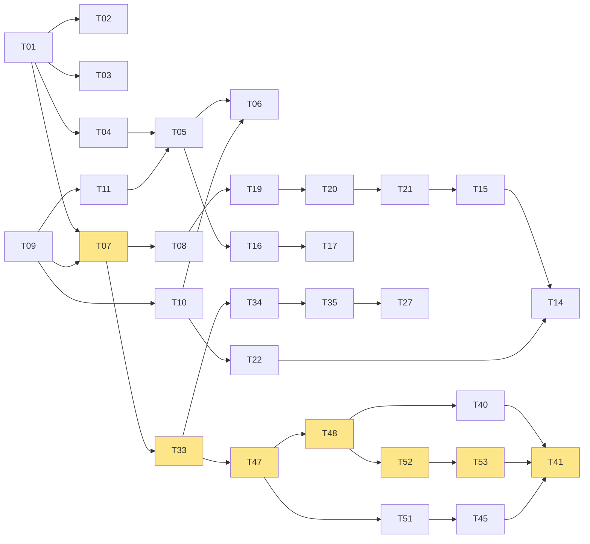

# Plano de Implementação, Release Plan e Orçamento

> **Versão:** 1.1.0 · **Data:** 25/11/2026 · Rastreável a [prd.md](./prd.md), [architecture.md](./architecture.md), [data-model.md](./data-model.md), [api-spec.md](./api-spec.md)
> **Equivalência Spec Kit:** `tasks.md` + release plan + resumo de orçamento (memória detalhada em [budget-and-changes.md](./budget-and-changes.md)).

> [!IMPORTANT]
> Horas são **esforço humano estimado** (não medido). Valores monetários usam as **taxas fictícias** dos PDFs. Preços de LLM e infraestrutura são **hipóteses** a reconsultar com link e data (L-12, L-13).

---

## 1. Capacidade e equipe

| Pessoa | Papel | Taxa (R$/h) | Capacidade | Alocado | Folga |
|---|---|---|---|---|---|
| P1 | **FDE** — produto e implantação | 140 | 40 h | 38 h | 2 h |
| P2 | **AI Engineer** — harness | 160 | 40 h | 39 h | 1 h |
| P3 | **Software Engineer** — integrações | 110 | 40 h | 40 h | 0 h |
| P4 | **Platform** — LLMOps e qualidade | 130 | 40 h | 39 h | 1 h |
| | **Total** | | **160 h** | **156 h** | **4 h** |

Regras: 10 h/pessoa/semana; acumular papéis não aumenta horas; R0 e R1 compartilham a capacidade das semanas 1–2 (não há dupla contagem).

**Alocação por semana (h):**

| Semana | FDE | AI Eng. | SW Eng. | Platform | Total | Release |
|---|---|---|---|---|---|---|
| S1 | 10 | 10 | 10 | 10 | 40 | R0 |
| S2 | 10 | 10 | 10 | 10 | 40 | R1 |
| S3 | 9 | 10 | 10 | 10 | 39 | R2 |
| S4 | 9 | 9 | 10 | 9 | 37 | R2 |
| **Total** | **38** | **39** | **40** | **39** | **156** | |

---

## 2. Épicos

| Épico | Objetivo | RFs |
|---|---|---|
| **E0** Especificação e governança | Spec versionada, decisões, aceite | Todos |
| **E1** Plataforma e setup | Monorepo, CI, sandbox, ambientes, observabilidade | RNF04, RNF11, RNF19 |
| **E2** Harness de IA | Orquestração multi-LLM, limites, evals | RNF22–RNF24 |
| **E3** Conta e dados | Schema, autenticação, isolamento, LGPD | RF01–RF03, RN01 |
| **E4** F1 Disciplinas e critérios | Períodos, disciplinas, avaliações, pesos | RF04–RF07 |
| **E5** F2 Notas e média | Motor de cálculo, notas, histórico | RF08–RF11 |
| **E6** F3 Simulador e painel | Nota necessária, simulação, painel | RF12–RF15 |
| **E7** Release e operação | Testes de liberação, performance, deploy, rollback | RNF01–RNF05 |

---

## 3. Tarefas atômicas (ordenadas por dependência)

Legenda — **Agente:** M1 plano/revisão · M2 execução · M3 triagem/fixtures · — sem agente. **Risco A** = exige aprovação humana do plano antes da execução do agente.

### Semana 1 — R0 Base técnica

| ID | Tarefa | Épico | RF/RNF | Depende de | Responsável | Agente | Horas | Critério de conclusão |
|---|---|---|---|---|---|---|---|---|
| T01 | Consolidar constituição e spec v1.0.0 (docs prd, architecture, data-model, api-spec) | E0 | Todos | — | FDE | M1 aponta ambiguidades | 4 | Docs aprovados pelos 4; tag `spec-v1.0.0` |
| T02 | Descoberta com a faculdade: nota mínima, arredondamento, exame, escala, termos | E0 | L-02…L-08 | T01 | FDE | — | 3 | Lacunas L-02…L-06 respondidas por escrito ou premissa registrada |
| T03 | Revisão da spec com IA + registro de decisões (log de uso de IA) | E0 | — | T01 | FDE | M1 | 2 | ≥ 1 sugestão aceita e ≥ 1 rejeitada registradas com justificativa |
| T04 | Redigir ADR-001/002/003 | E0/E2 | — | T01 | AI Eng. | M1 rascunho | 2 | 3 ADRs em `docs/adr/` aprovados |
| T05 | Harness mínimo: Deep Agents + roteador M1/M2/M3, timeout e máx. tentativas | E2 | RNF23 | T04, T11 | AI Eng. | — | 5 | Executa uma tarefa fictícia ponta a ponta no sandbox, com logs JSONL |
| T06 | Fluxo vertical verificável: agente implementa `GET /health` (E01) → PR → CI → preview | E2 | RNF04 | T05, T10 | AI Eng. | M1+M2 | 2 | PR aberto pelo agente, CI verde, preview respondendo 200 |
| T07 | Schema Prisma, migrações, constraints e seeds sintéticos (Risco A) | E3 | RN01–RN17 | T01, T09 | SW Eng. | M2 | 4 | `migrate deploy` em DB vazio; testes de constraints (soma pesos, FKs compostas) verdes |
| T08 | Autenticação: cadastro, login, refresh rotativo, logout, bloqueio, CSRF, cookies (Risco A) | E3 | RF01, RF02, RNF07, RNF08, RNF10 | T07 | SW Eng. | M2 | 5 | CA01.1–CA02.5 automatizados e verdes |
| T09 | Monorepo pnpm/Turbo, lint, tsconfig strict, devcontainer, CODEOWNERS, template de PR | E1 | RNF15 | — | Platform | M2 boilerplate | 2 | `pnpm build` e `pnpm lint` verdes; template exige RF/Txx/versão da spec |
| T10 | CI GitHub Actions: lint, typecheck, testes, build, gitleaks, audit, verificação de paths | E1 | C2, RNF11 | T09 | Platform | M2 | 3 | Pipeline bloqueia PR com teste quebrado ou segredo |
| T11 | Sandbox Docker para agentes: rede restrita, sem segredos, paths permitidos | E1/E2 | C3, RNF22 | T09 | Platform | — | 4 | Agente não consegue ler `.env` nem acessar rede fora da allowlist (teste manual registrado) |

### Semana 2 — R1 Piloto (F1 utilizável)

| ID | Tarefa | Épico | RF/RNF | Depende de | Responsável | Agente | Horas | Critério de conclusão |
|---|---|---|---|---|---|---|---|---|
| T12 | Wireframes F1 (mobile-first) | E4 | RF04–RF06, RNF17 | T01 | FDE | — | 2 | Wireframes aprovados pelo SW Eng. |
| T13 | Publicar termos de uso e política de privacidade (versão `2026-11`) | E3 | RF01, D-02 | T02 | FDE | — | 1 | Texto aprovado pela faculdade e versionado |
| T14 | Piloto R1: recrutar 5–15 estudantes, onboarding, formulário de feedback | E0 | Métricas §7 do PRD | T22, T15 | FDE | — | 4 | Convites enviados; ≥ 5 contas ativas; formulário publicado |
| T15 | Validação de aceite F1 (roteiro manual dos CAs) | E4 | RF04–RF06 | T21 | FDE | — | 2 | Checklist CA04–CA06 assinado |
| T16 | Contrato completo do harness: checkpoints, `progress.md`, limites de tokens/gasto, scanner de PII, retomada | E2 | RNF22, RNF23 | T05 | AI Eng. | — | 4 | Retomada após interrupção comprovada; tarefa acima do limite é interrompida |
| T17 | Evals do harness EV01–EV04 com fixtures sintéticos | E2 | RNF22–RNF24 | T16 | AI Eng. | M3 gera fixtures | 3 | Suíte roda no CI (`harness-evals.yml`) e publica relatório |
| T18 | Supervisão das execuções F1 (contexto, prompts, ajustes de paths) | E2/E4 | — | T16 | AI Eng. | M1/M2 | 2 | T19–T21 executadas com ≤ 3 ciclos cada; desvios registrados |
| T19 | API períodos e disciplinas (E10–E19) | E4 | RF04, RF05 | T08 | SW Eng. | M2 | 3 | CA04.x e CA05.x verdes em integração |
| T20 | API avaliações, soma de pesos, confirmação, ordenação (E20–E23) (Risco A) | E4 | RF06, RN03 | T19 | SW Eng. | M2 | 3 | CA06.x verdes; teste de concorrência de soma de pesos verde |
| T21 | UI F1: períodos, disciplinas, avaliações | E4 | RF04–RF06, RNF16 | T12, T20 | SW Eng. | M2 | 3 | Fluxo navegável em staging, axe sem violações sérias |
| T22 | Ambientes preview/staging/produção, segredos, migração via CI | E1 | RNF05 | T10 | Platform | — | 3 | Deploy automático `main`→staging; produção por tag |
| T23 | Observabilidade: Pino, Sentry (sem PII), monitor de uptime | E1 | RNF19 | T22 | Platform | M2 | 2 | Erro forçado aparece no Sentry em < 5 min, sem e-mail no payload |
| T24 | Suíte de autorização/IDOR (2 usuários sintéticos × todos os endpoints) | E3 | RN01, RNF09 | T19 | Platform | M2 | 3 | Suíte bloqueante no CI; 0 falhas |
| T25 | Revisão dos testes de integração F1 gerados pelo agente | E4 | RF04–RF06 | T20 | Platform | M2 | 1 | Cobertura backend F1 ≥ 80 % |

### Semana 3 — R2 (parte 1: F2)

| ID | Tarefa | Épico | RF/RNF | Depende de | Responsável | Agente | Horas | Critério de conclusão |
|---|---|---|---|---|---|---|---|---|
| T26 | Wireframes F2 e F3 (lançamento rápido, painel, simulador) | E5/E6 | RF08, RF14, RNF18 | T14 | FDE | — | 2 | Aprovados; lançamento de nota em ≤ 3 interações |
| T27 | Validação de aceite F2 | E5 | RF08–RF11 | T35 | FDE | — | 2 | Checklist CA08–CA11 assinado |
| T28 | Consolidar feedback do piloto → spec v1.1.0 | E0 | — | T14 | FDE | M1 resume feedback (anonimizado) | 2 | Changelog da spec + tarefas afetadas atualizadas |
| T29 | Atualizar orçamento e release plan com dados reais de S1–S2 | E0 | — | T39 | FDE | — | 2 | Planilha com fórmulas atualizada |
| T30 | Supervisão das execuções F2/F3 | E2 | — | T17 | AI Eng. | M1/M2 | 4 | T33–T35, T47–T48 com ≤ 3 ciclos; relatório de custos por tarefa |
| T31 | Hardening: simular timeout, indisponibilidade de M2, estouro de orçamento; validar fallback M3 | E2 | RNF23 | T16 | AI Eng. | M3 | 3 | CT06 e CT07 verdes |
| T32 | Ajustar evals e prompts com base nas falhas do R1 | E2 | — | T18 | AI Eng. | M1 | 2 | Taxa de aprovação nos gates em ≤ 2 ciclos ≥ 70 % |
| T33 | Motor de cálculo `@app/domain`: estratégias SIMPLES/PONDERADA, substitutiva (RN19), exame final (RN20/RN21), arredondamento, status, nota necessária e prévia (Risco A) | E5 | RF09, RF10, RF12, RF15, RN06–RN10, RN19–RN21 | T07 | SW Eng. | M1+M2 | 4 | CA09–CA10, CA12, CA15 verdes; cobertura ≥ 95 % |
| T34 | API notas (regulares, substitutiva e exame final), histórico e alteração de critérios com prévia (E18, E24–E27, E30, E32–E35) | E5 | RF07, RF08, RF11, RN19–RN21 | T33, T20 | SW Eng. | M2 | 3 | CA07.x, CA08.x, CA11.x verdes; histórico na mesma transação |
| T35 | UI F2: lançamento de notas regulares, substitutiva e exame final, média e histórico | E5 | RF08–RF11, RNF18, RNF21 | T26, T34 | SW Eng. | M2 | 2 | Vírgula decimal aceita; média e status pós-sub/exame atualizam sem recarregar |
| T36 | Testes de propriedade do motor (fast-check) incluindo substitutiva e exame final | E5 | RNF14 | T33 | Platform | M2 | 3 | Propriedades: média ∈ [0,10], substitutiva nunca reduz média, monotonicidade, SIMPLES = PONDERADA com pesos iguais |
| T37 | Segurança: CSP/headers, rate limit, revisão OWASP ASVS L1 | E7 | RNF08, RNF10, RNF11 | T23 | Platform | M1 checklist | 2 | Relatório ASVS L1 sem pendências altas |
| T38 | Teste de carga k6 em staging | E7 | RNF01, RNF02 | T34 | Platform | M2 script | 2 | p95 leitura < 300 ms; escrita < 500 ms |
| T39 | Monitor de custo de LLM: painel por tarefa/semana, alerta 80 % | E2 | RNF23 | T16 | Platform | — | 2 | Alerta disparado em teste com limite reduzido |

### Semana 4 — R2 (parte 2: F3, liberação)

| ID | Tarefa | Épico | RF/RNF | Depende de | Responsável | Agente | Horas | Critério de conclusão |
|---|---|---|---|---|---|---|---|---|
| T40 | Validação de aceite F3 | E6 | RF12–RF15 | T48 | FDE | — | 2 | Checklist CA12–CA15 assinado |
| T41 | Aceite com a faculdade e decisão de go-live | E0 | — | T40, T45, T53 | FDE | — | 3 | Termo de aceite assinado (ou lista de bloqueios) |
| T42 | Material de adoção (guia rápido, FAQ) | E0 | — | T40 | FDE | M1 rascunho | 1 | Publicado no app |
| T43 | Análise de mudança de requisito e replanejamento (§8) | E0 | — | T29 | FDE | M1 | 2 | Spec revisada + impacto em horas/custo/prazo registrado |
| T44 | Supervisão F3 + retrabalho previsto via agentes | E2 | — | T30 | AI Eng. | M1/M2 | 3 | Correções do piloto mergeadas |
| T45 | Eval de liberação: relatório de evidências CT01–CT08 + EV01–EV04 | E7 | §5 | T51, T52 | AI Eng. | M3 resume logs | 3 | Relatório anexado à release `v1.0.0` |
| T46 | Runbook do harness (falhas, retomada, rotação de chaves, troca de provedor) | E2 | — | T31 | AI Eng. | M1 rascunho | 2 | Revisado pelo Platform |
| T47 | API F3: nota necessária, simulação, painel (E28, E29, E31) | E6 | RF12–RF15 | T33 | SW Eng. | M2 | 4 | CA12.x–CA14.x verdes; CA14.4 medido |
| T48 | UI F3: painel do período e simulador | E6 | RF13, RF14, RNF16 | T26, T47 | SW Eng. | M2 | 2 | Destaque textual + visual de risco; axe ok |
| T49 | Perfil, exportação e exclusão de conta (E06–E09) (Risco A) | E3 | RF03, RN17 | T08 | SW Eng. | M2 | 2 | CA03.x verdes; exclusão remove 100 % das linhas do usuário |
| T50 | Retrabalho previsto (bugs do piloto) | E7 | — | T28 | SW Eng. | M2 | 1 | Bugs críticos/altos do piloto fechados |
| T51 | Testes de integração F3 e regressão | E6 | RF12–RF15 | T47 | Platform | M2 | 2 | Cobertura backend ≥ 80 % |
| T52 | E2E Playwright (fluxo crítico) + axe-core | E7 | RNF16, RNF20 | T48 | Platform | M2 | 3 | Verde em Chromium e WebKit |
| T53 | Deploy produção, runbook de rollback, teste de restauração de backup | E7 | RNF05, C6 | T22, T52 | Platform | — | 3 | Rollback ensaiado em staging < 5 min; restauração PITR testada |

### Transversal

| ID | Tarefa | Responsável | Horas | Critério |
|---|---|---|---|---|
| T00 | Coordenação semanal (planejamento, revisão de PRs críticos, risco) | Todos (1 h/pessoa/semana) | 16 | Ata semanal com decisões |

**Verificação de soma por pessoa:** FDE = 4+3+2+2+1+4+2+2+2+2+2+2+3+1+2+4(T00) = 38 · AI Eng. = 2+5+2+4+3+2+4+3+2+3+3+2+4 = 39 · SW Eng. = 4+5+3+3+3+4+3+2+4+2+2+1+4 = 40 · Platform = 2+3+4+3+2+3+1+3+2+2+2+2+3+3+4 = 39.

### 3.1 Grafo de dependências (caminho crítico em destaque)

### 3.2 Contrato de execução de uma tarefa (exemplo: T33)

| Campo | Valor |
|---|---|
| Tarefa / requisitos | T33 · RF09, RF10, RF12, RF15 · RN06–RN10 |
| Spec | `docs/prd.md` @ `spec-v1.0.0` (seções 3 e 4.3–4.4) |
| Paths permitidos (escrita) | `packages/domain/**` |
| Paths de leitura | `packages/contracts/**`, `docs/**` |
| Agentes / modelos | Plano: M1 · Execução: M2 · Triagem: M3 · Revisão: M1 |
| Ferramentas | `read_repo`, `search_code`, `write_file(paths)`, `run_tests --filter domain`, `run_lint` |
| Entrada | CAs CA09.1–CA10.4, CA12.1–CA12.4, CA15.1–CA15.3 como casos de teste obrigatórios |
| Saída esperada | PR `agent/T33-motor-calculo` com código, testes, relatório de cobertura e custo |
| Limites | 30 min, 3 ciclos, 1,5 M tokens entrada / 120 k saída, US$ 8,00 |
| Verificação | Vitest verde; cobertura ≥ 95 %; nenhum `number` em operações de nota (regra de lint customizada); revisão M1 sem bloqueios |
| Aprovação | Plano: SW Eng. (Risco A) · Merge: SW Eng. (CODEOWNER de `packages/domain`) |
| Falha | 3 ciclos sem sucesso ou limite excedido → checkpoint, `ESCALATED`, SW Eng. assume manualmente |

---

## 4. Release plan

| | **R0 — Base técnica** | **R1 — Piloto** | **R2 — Entrega do recorte** |
|---|---|---|---|
| Janela | Semana 1 | Semana 2 (fim) | Semanas 3–4 |
| Objetivo | Harness mínimo, sandbox, fluxo vertical verificável | F1 utilizável por público piloto + coleta de feedback | F1+F2+F3 integradas, correções do piloto, operação pronta |
| Requisitos | E01, base de RF01/RF02, schema | RF01, RF02, RF04–RF06 | RF03, RF07–RF15 + todos os RNF |
| Tarefas | T01–T11 | T12–T25 | T26–T53 |
| Dependências | — | R0; D-02 termos; D-03 piloto | R1; feedback do piloto; D-01 regras |
| Horas (FDE/AI/SW/Plat) | 10 / 10 / 10 / 10 = **40 h** | 10 / 10 / 10 / 10 = **40 h** | 18 / 19 / 20 / 19 = **76 h** |
| Custo humano | R$ 5.400,00 | R$ 5.400,00 | R$ 10.230,00 |
| Custo total c/ IA e infra (sem reserva) | R$ 5.827,66 | R$ 6.030,32 | R$ 11.423,08 |
| Aprovador | AI Engineer | FDE | FDE (produto) + Platform (operação) |
| Público | Interno (equipe) | 5–15 estudantes piloto | Estudantes da faculdade (lançamento controlado) |
| Métricas de aceite | CI verde; PR do agente mergeado; EV01 ok | CA04–CA06 ok; CT04, CT05 ok; ≥ 5 pilotos ativos; 0 incidentes de dados | CT01–CT08 ok; RNF01/03/16 medidos; satisfação ≥ 4,0; 0 bugs críticos abertos |
| Rollback | Revert de PR; recriar sandbox | "Promote previous deployment" Vercel; migrações expand-only | Idem + PITR do banco; feature flag desliga F3 (painel/simulador) isoladamente |

---

## 5. Critérios de liberação baseados em evidência

### 5.1 Oito casos de teste/avaliação

| ID | Categoria | Entrada | Resultado esperado | Método | Responsável |
|---|---|---|---|---|---|
| **CT01** | Regra de produto | P1=8 (40), P2=6 (40), T=9 (20), PONDERADA | Média final 7,4; `APROVADO` | Teste unitário + integração E27 | SW Eng. |
| **CT02** | Regra de produto | Pesos 33,33/33,33/33,34; notas 7/8/9; e média exata 6,95 com 1 casa | 8,0 (exato `8.0001`); 7,0 (HALF_UP) | Unitário + propriedade | Platform |
| **CT03** | Aceite de produto | P1=5 (40) lançada, P2 e T pendentes, mínima 6,0 | Nota necessária 6,7; situação `EM_RISCO` | Integração E28 + E2E painel | FDE (aceite) |
| **CT04** | Autorização/isolamento | Usuário B chama GET/PATCH/DELETE em recursos de A (todos os endpoints) | 404 em 100 % dos casos; dados de A inalterados | Suíte IDOR automatizada | Platform |
| **CT05** | Autorização/sessão | Refresh token reutilizado; access expirado; sem CSRF | Família revogada → 401; 401; 403 `CSRF_INVALIDO` | Integração | SW Eng. |
| **CT06** | Falha do harness | Tarefa com teste que nunca passa / chamada LLM que excede 10 min | Interrompe após 3 ciclos / timeout; checkpoint salvo; status `ESCALATED`; notificação ao responsável | Eval EV01 no CI | AI Eng. |
| **CT07** | Limite do harness | Tarefa com orçamento configurado em US$ 0,10 | Execução parada ao atingir o limite; nenhum PR aberto; custo registrado | Eval EV02 | AI Eng. |
| **CT08** | Rastreabilidade/qualidade do agente | PR gerado por agente para T33 | PR contém Txx, RFs, versão da spec, relatório de testes, custo; diff só em paths permitidos; scanner de PII = 0 | Verificação automática no CI + revisão humana | AI Eng. + SW Eng. |

### 5.2 Evals do harness
| ID | Avalia | Limiar |
|---|---|---|
| EV01 | Timeout e máx. tentativas | 100 % das execuções interrompidas corretamente |
| EV02 | Limite de gasto/tokens | 100 % paradas antes de exceder o limite + 5 % |
| EV03 | Qualidade do plano (M1) em 10 tarefas rotuladas | ≥ 8/10 planos cobrem todos os CAs |
| EV04 | Violação de política (path proibido, PII em fixture) | 100 % bloqueadas |

### 5.3 Regras de bloqueio
- **Bloqueiam a release:** qualquer falha em CT01–CT08; vulnerabilidade crítica/alta; violação axe séria/crítica; p95 acima do RNF01 em > 20 %; teste de restauração não executado (R2).
- **Tempo máximo de execução:** CI completo ≤ 15 min; tarefa de agente ≤ 30 min.
- **Orçamento por tarefa de agente:** ≤ US$ 8,00; semanal ≤ US$ 90,00.
- Avaliação por LLM (revisão M1) é **complementar** e nunca critério único de liberação.

---

## 6. Orçamento

### 6.1 Premissas de consumo de IA na engenharia (hipóteses)

| Item | Valor |
|---|---|
| Tarefas executadas com apoio de agente | 40 (das 53) |
| Ciclos por tarefa (inclui novas tentativas — **sem** fator de retry adicional) | 2,5 em média |
| M1 planejamento | 40 × 1 chamada × 60 k entrada / 6 k saída |
| M1 revisão | 40 × 2,5 × 1 chamada × 40 k / 3 k |
| M2 execução | 40 × 2,5 × 15 chamadas × 25 k / 2 k |
| M2 evals (EV01–EV04, testes do harness) | 80 execuções × 10 chamadas × 20 k / 1,5 k |
| M3 triagem/fixtures | 40 × 2 chamadas × 10 k / 1 k |
| Cache, batch e ferramentas cobradas | Não considerados (otimização futura; reduziria custo) |
| Câmbio | R$ 5,50/US$ (hipótese, L-13) |
| IOF sobre serviço internacional | 3,5 % (hipótese) |
| Data das cotações | **A preencher** com link oficial (OpenAI API, Claude API, Gemini API) |

### 6.2 Cálculo da API por modelo
Fórmula: `(tokens entrada / 1.000.000 × preço entrada) + (tokens saída / 1.000.000 × preço saída)`

| Modelo | Tokens entrada | Tokens saída | Preço (US$/1M in / out) | Custo US$ |
|---|---|---|---|---|
| M1 | 6,40 M | 0,54 M | 1,25 / 10,00 | 8,00 + 5,40 = **13,40** |
| M2 | 53,50 M | 4,20 M | 3,00 / 15,00 | 160,50 + 63,00 = **223,50** |
| M3 | 0,80 M | 0,08 M | 0,30 / 2,50 | 0,24 + 0,20 = **0,44** |
| **Total** | 60,70 M | 4,82 M | | **US$ 237,34** |

US$ 237,34 × 5,50 = R$ 1.305,37 + IOF 3,5 % (R$ 45,69) = **R$ 1.351,06**.

### 6.3 Construção

| Bloco | Composição | Valor (R$) |
|---|---|---|
| Pessoas | FDE 38 h × 140 = 5.320 · AI 39 h × 160 = 6.240 · SW 40 h × 110 = 4.400 · Plat 39 h × 130 = 5.070 | **21.030,00** |
| IA — API dos modelos | §6.2 | **1.351,06** |
| IA — licenças de assistentes (4 pessoas, 1 mês) | Premissa da Parte 1 (não inclui uso de API) | **600,00** |
| Infraestrutura dev/testes (1 mês) | GitHub, CI, Neon/Vercel não-prod, sandbox | **300,00** |
| **Custo-base de construção** | | **23.281,06** |
| Reserva (10 %) — mostrada separadamente | | **2.328,11** |
| **Construção com reserva** | base × 1,10 | **25.609,17** |

### 6.4 Custo por release
Rateio: horas reais por release; API 15 % / 30 % / 55 % (proporcional às execuções de agente); licenças e infra por semana.

| Release | Pessoas | API | Licenças + infra | Base | Com reserva (×1,10) |
|---|---|---|---|---|---|
| R0 | 5.400,00 | 202,66 | 225,00 | 5.827,66 | 6.410,43 |
| R1 | 5.400,00 | 405,32 | 225,00 | 6.030,32 | 6.633,35 |
| R2 | 10.230,00 | 743,08 | 450,00 | 11.423,08 | 12.565,39 |
| **Total** | **21.030,00** | **1.351,06** | **900,00** | **23.281,06** | **25.609,17** |

### 6.5 Custo por funcionalidade (mão de obra) e compartilhados

| Bloco | Tarefas | Horas | Custo (R$) |
|---|---|---|---|
| F1 Disciplinas e critérios | T12, T15, T18, T19, T20, T21, T25 | 16 | 2.000,00 |
| F2 Notas e média | T27, ½T26, ½T30, T33, T34, T35, T36 | 17 | 2.120,00 |
| F3 Simulador e painel | T40, ½T26, ½T30, T47, T48, T51 | 13 | 1.660,00 |
| Compartilhados (spec, harness, setup, auth, LGPD, segurança, release, coordenação) | demais | 110 | 15.250,00 |
| **Total** | | **156** | **21.030,00** |

**Tarefas mais caras ou incertas:**
- **T05 / T16 (harness, R$ 1.440)** — maior incerteza: integração multi-provedor e limites de custo são novos para a equipe; mitigado por adotar framework existente (ADR-001).
- **T08 (auth, R$ 550)** — risco de segurança; Risco A com revisão humana obrigatória.
- **T33 (motor de cálculo, R$ 440)** — erro aqui invalida o produto; exige testes de propriedade (T36).
- **T14 (piloto, R$ 560)** — depende de recrutamento externo (D-03).

### 6.6 Operação após a entrega (mensal)

| Item | Premissa | R$/mês |
|---|---|---|
| Infraestrutura de produção | Vercel Pro (1 assento) + Neon plano pago + domínio; Sentry/Upstash em plano gratuito — hipótese com margem | 350,00 |
| Suporte e manutenção | 4 h Platform (520) + 4 h SW Eng. (440) | 960,00 |
| Tokens para manutenção via harness | ~10 tarefas pequenas/mês (hipótese) | 150,00 |
| IA no produto | Não existe no MVP | 0,00 |
| **Total mensal** | | **1.460,00** |
| **Projeção 3 primeiros meses** | | **4.380,00** |

### 6.7 Sensibilidade: +50 % de tokens
| Item | Base | +50 % tokens | Δ |
|---|---|---|---|
| API construção | 1.351,06 | 2.026,59 | +675,53 |
| Construção com reserva | 25.609,17 | **26.352,25** | **+743,08** |
| Operação mensal | 1.460,00 | 1.535,00 | +75,00 |
| Operação 3 meses | 4.380,00 | 4.605,00 | +225,00 |

### 6.8 Referência — orçamento no modelo da Parte 1 (taxa uniforme)
156 h × R$ 100 = 15.600 + ferramentas IA 600 + infra 300 = 16.500 → × 1,10 = **R$ 18.150,00**. A diferença para a Parte 2 vem das taxas por papel e do consumo de API agora explicitado.

---

## 7. Riscos de cronograma
| Risco | Gatilho | Resposta |
|---|---|---|
| SW Eng. com 0 h de folga | Qualquer tarefa SW atrasar > 2 h | Reduzir escopo na ordem: E30 (prévia) → RF13 simulação → "próximas avaliações" no painel |
| Harness não pronto ao fim da S1 | T05/T06 incompletos | Seguir R1 com agentes em modo assistido (IDE) e manter gates de CI; harness completo migra para S2 |
| Piloto sem voluntários | < 5 inscritos até meio da S2 | FDE aciona coordenação; piloto interno com monitores |

---

## 8. Mudança de requisito e replanejamento

### 8.1 MR-01 (alteração de regra de negócio, antes da implementação de F2): **Controle de Frequência e Reprovação por Falta (< 75%)**
> Nova regra informada pela faculdade: toda disciplina possui `cargaHorariaTotal` (em aulas, ex.: 60 aulas) e `faltasRegistradas` (inteiro ≥ 0), com frequência mínima obrigatória de **75%** (máximo de 25% de faltas). Se `faltasRegistradas > 0,25 × cargaHorariaTotal`, a situação da disciplina passa imediatamente para `REPROVADO_POR_FALTA` (prioridade máxima acima de nota), mesmo que a média de notas seja ≥ 6,0; se as faltas atingirem ≥ 20% da carga horária (80% do limite de faltas), o painel exibe alerta `RISCO_POR_FALTA`.

**Mudanças na especificação (spec v1.2.0):**
- PRD: novas `RN22` (cálculo de frequência e limite de 25% de faltas) e `RN23` (precedência de `REPROVADO_POR_FALTA` sobre aprovação por nota); novos estados `REPROVADO_POR_FALTA` e badge `RISCO_POR_FALTA` em RF14/RF15; novo `RF16 — Lançar faltas e calcular saldo de faltas restantes`.
- Data model: `disciplina.carga_horaria_aulas SMALLINT NOT NULL DEFAULT 60 CHECK (> 0)`, `disciplina.faltas_registradas SMALLINT NOT NULL DEFAULT 0 CHECK (>= 0)`, `disciplina.frequencia_minima_pct NUMERIC(5,2) NOT NULL DEFAULT 75.00`.
- API: campos de frequência em `E16`/`E18`; novo endpoint `PUT /disciplinas/{id}/faltas`; objeto `Desempenho.frequencia` (`aulasTotais`, `faltas`, `faltasMaximasPermitidas`, `saldoFaltas`, `percentualPresenca`, `emRiscoFalta`, `reprovadoPorFalta`).

**Impacto nas tarefas:**

| Tarefa | Mudança | Δ horas | Pessoa |
|---|---|---|---|
| T43 | Revisar spec, plano e orçamento (esforço de replanejamento) | +2 | FDE |
| T33 | Cálculo de frequência, saldo de faltas e precedência `REPROVADO_POR_FALTA` no `@app/domain` | +2 | SW Eng. |
| T07/T34 | Colunas de frequência na `disciplina` + endpoint `PUT /disciplinas/{id}/faltas` | +2 | SW Eng. |
| T35/T48 | Contador rápido de faltas (`- / +`) e barra de saldo de faltas no card da disciplina | +1 | SW Eng. |
| T36 | Testes de propriedade e borda (arredondamento de 25% em cargas horárias ímpares, precedência falta vs nota 10) | +2 | Platform |
| T30 | Supervisão adicional do agente M2 | +1 | AI Eng. |
| **Subtotal adicionado** | | **+10** | |
| Corte (Opção A — manter 160 h): RF13 simulação "e se" (E29) → pós-MVP | T47/T48/T51 reduzidos | −3 SW, −1 Plat | |
| Corte (Opção A): E30 prévia de critérios (manter só confirmação) | T34 reduzido | −1 SW | |
| Corte (Opção A): "próximas avaliações" no painel | T47 reduzido | −1 SW | |
| **Líquido (Opção A)** | | **+4 h** | FDE +2, AI +1, SW 0, Plat +1 |

**Novo total:** 160 h (FDE 40, AI 40, SW 40, Plat 40) — dentro da capacidade, **sem folga**.
**Novo custo:** pessoas +R$ 570 (2×140 + 160 + 130); API +5 % (+R$ 67,55) → base R$ 23.918,61 → **com reserva R$ 26.310,47** (+R$ 701,30).
**Prazo:** mantido em 4 semanas, mas com risco elevado (0 h de folga). **Alternativa B:** manter RF13 e E30 e estender 1 semana apenas para o SW Eng. (+5 h ≈ R$ 550 + R$ 75 infra/licenças proporcionais) → entrega na semana 5.

### 8.2 Eventos de replanejamento da Parte 2 (pré-análise)

| Evento | Impacto em escopo | Δ esforço | Δ custo (com reserva) | Δ prazo |
|---|---|---|---|---|
| **E1** Modelo principal (M2) indisponível 48 h | Tarefas de baixo risco vão para M3; Risco A pausadas ou feitas manualmente | +3 h SW (manual), +1 h AI (roteamento) — absorvido cortando E30 | ≈ R$ 0 líquido (−M2 tokens, +horas já existentes) | 0 se ocorrer fora do caminho crítico; até +2 dias se em T33/T47 |
| **E2** +50 % no consumo de tokens | Nenhum | 0 h | +R$ 743,08 (§6.7); limite semanal sobe para US$ 135 | 0 |
| **E3** Restrição de envio de dados acadêmicos a um fornecedor | Nenhum dado acadêmico é enviado (RN18) → registrar conformidade; se o fornecedor for vetado por completo, substituir modelo afetado e reexecutar EV03 | +1 h FDE, +3 h AI (só se veto total) | +R$ 140 a R$ 620 | 0 |
| **E4** Alteração de regra de negócio | Ver MR-01 | +4 h líquidas | +R$ 701,30 | 0 (opção A) ou +1 semana (opção B) |

### 8.3 Reflexão: SDD torna o processo cascata?
Não, desde que a spec seja **viva e incremental**: (1) a spec é versionada (semver) e muda por PR com o mesmo rigor do código; (2) cada release (R0→R1→R2) entrega software utilizável e o feedback do piloto gera nova versão da spec (T28); (3) mudanças atualizam *todos* os artefatos afetados (PRD → dados → API → tarefas → orçamento), preservando rastreabilidade; (4) só a fatia da próxima release é detalhada ao nível de tarefa atômica. O que o SDD evita é implementar sem critério verificável — não a mudança.

---

## 9. Registro de uso de IA (modelo a preencher pelo grupo)

| Campo | Registro |
|---|---|
| Ferramenta | Assistente de IA em IDE (Antigravity) para estruturar a spec; harness Deep Agents com M1/M2/M3 (planejado) |
| Prompt relevante | "Atue como Engenheiro de Software Sênior… extraia regras de negócio, RF/RNF… e liste ambiguidades" |
| Sugestão aceita | Usar aritmética decimal exata e arredondar só na exibição (RN07) — elimina erro de ponto flutuante (CA10.3) |
| Sugestão rejeitada/corrigida | Incluir assistente de estudo com IA para o estudante — **rejeitada**: não justificado pelo recorte, adicionaria custo recorrente e risco à política de dados (Parte 2) |
| Validação humana | Responsável: FDE (T03); decisões registradas em `harness/state/decisions.jsonl` |
