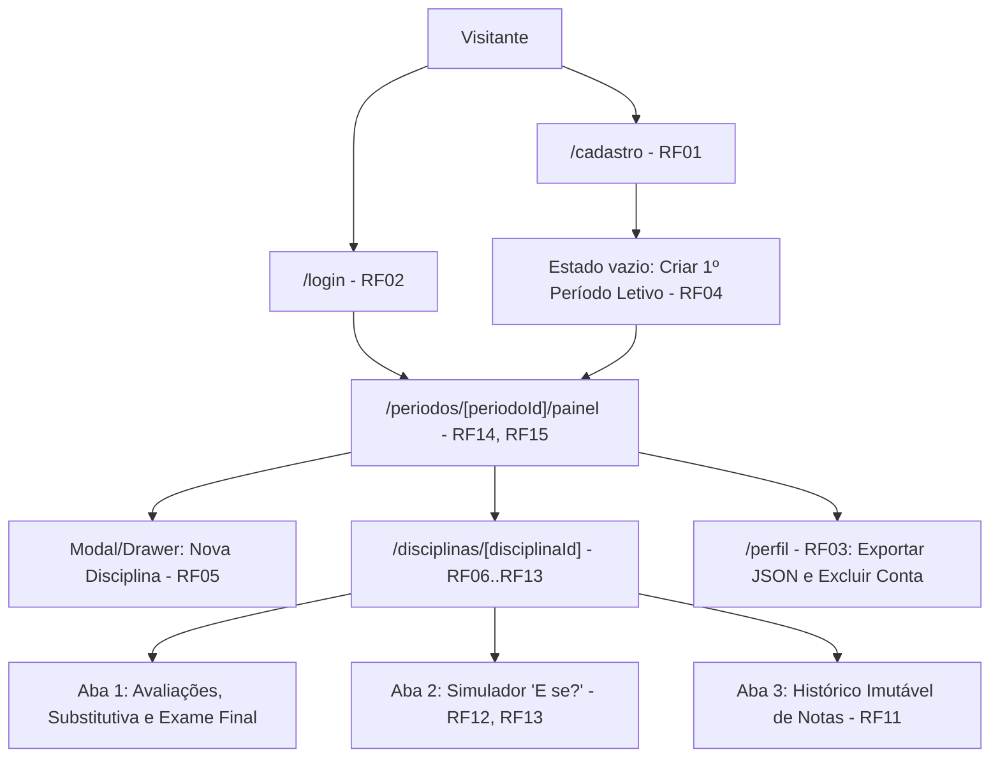

# Especificação de Interface, Fluxos de Telas e Acessibilidade (`ui-ux-spec.md`)

> **Versão:** 1.1.0 · **Data:** 25/11/2026 · **Responsável:** FDE + Software Engineer
> **Rastreabilidade:** [prd.md](./prd.md) (`RF01`–`RF15`, `RNF03`, `RNF16`–`RNF18`, `RNF20`, `RNF21`), [api-spec.md](./api-spec.md)

---

## 1. Diretrizes de Design e Experiência (Mobile-First)

1. **Dispositivo Primário:** Smartphone (`360px` a `430px` de largura), escalando com layout responsivo em grid de até 3 colunas no desktop (`1024px`–`1440px`) (`RNF17`).
2. **Regra das 3 Interações (`RNF18`):** A partir do Painel do Período, o estudante deve conseguir lançar ou editar uma nota em **no máximo 3 toques/cliques**:
   - *Toque 1:* Tocar no botão rápido `[Lançar nota]` da avaliação pendente diretamente no card da disciplina (ou abrir a disciplina);
   - *Toque 2:* Digitar a nota no campo numérico com teclado decimal mobile (`inputmode="decimal"`, aceitando vírgula `7,5` ou ponto `7.5` — `CA08.4`);
   - *Toque 3:* Confirmar em `[Salvar]` (ou pressionar `Enter`), atualizando média, situação e nota necessária instantaneamente sem reload de página.
3. **Acessibilidade Obrigatória (`RNF16` — WCAG 2.1 AA):**
   - **Nunca usar apenas cor** para transmitir situação (`CA14.2`): todo badge de status combina **Cor de fundo/borda + Ícone SVG explícito + Rótulo textual em português**.
   - Contraste mínimo de **4.5:1** para texto normal e **3:1** para elementos gráficos.
   - Alvos de toque (*touch targets*) com no mínimo **44×44 px** no mobile.

---

## 2. Mapa de Rotas e Fluxo de Navegação



---

## 3. Sistema Visual de Situações da Disciplina (`RF15`)

| Situação (`SituacaoDisciplina`) | Prioridade no Painel | Cor (Tailwind / Badge) | Ícone + Rótulo Textual Obrigatório | Microcopy Explicativo no Card |
|---|---|---|---|---|
| `REPROVACAO_INEVITAVEL` | **1 (Topo)** | Vermelho escuro (`bg-red-100 text-red-900 border-red-400`) | `[!] Reprovação inevitável` | *"Mesmo com nota 10 nas pendentes, a média não atinge o mínimo."* |
| `AGUARDANDO_SUBSTITUTIVA` | **1 (Topo)** | Roxo (`bg-purple-100 text-purple-900 border-purple-400`) | `[↻] Precisa de Substitutiva` | *"Média abaixo de 4,0. Lance a Prova Substitutiva para tentar alcançar o exame/aprovação."* |
| `EM_EXAME_FINAL` | **2** | Laranja escuro (`bg-orange-100 text-orange-900 border-orange-400`) | `[⚑] Em Exame Final` | *"Precisa tirar **X,X** no Exame Final para fechar com média pós-exame ≥ 5,0."* |
| `EM_RISCO` | **2** | Âmbar (`bg-amber-100 text-amber-900 border-amber-400`) | `[⚠] Atenção / Em risco` | *"Precisa de média **X,X** nas avaliações restantes (acima do seu ritmo atual)."* |
| `CONFIGURACAO_INCOMPLETA` | **3** | Cinza tracejado (`bg-slate-100 text-slate-800 border-dashed border-slate-400`) | `[⚙] Pesos incompletos` | *"Soma atual: **XX%**. Adicione ou ajuste avaliações até somar 100%."* |
| `EM_ANDAMENTO` | **4** | Azul (`bg-blue-100 text-blue-900 border-blue-300`) | `[●] Em andamento` | *"No ritmo: precisa de **X,X** nas avaliações pendentes."* |
| `SEM_NOTAS` | **4** | Neutro (`bg-gray-100 text-gray-800 border-gray-300`) | `[○] Sem notas lançadas` | *"Configuração pronta. Lance a 1ª nota quando realizar a avaliação."* |
| `APROVACAO_GARANTIDA` | **5** | Verde claro (`bg-emerald-100 text-emerald-900 border-emerald-400`) | `[✓] Aprovação garantida` | *"Pontos acumulados (**X,X**) já atingiram a média mínima!"* |
| `APROVADO` | **5** | Verde sólido (`bg-green-100 text-green-900 border-green-500`) | `[★] Aprovado` | *"Disciplina concluída com média final **X,X**."* |
| `APROVADO_POS_EXAME` | **5** | Verde-azulado (`bg-teal-100 text-teal-900 border-teal-500`) | `[★] Aprovado no Exame` | *"Média pós-exame **X,X** (Regular X,X + Exame X,X)."* |
| `REPROVADO` / `REPROVADO_POS_EXAME` | **6** | Vermelho neutro (`bg-rose-100 text-rose-900 border-rose-400`) | `[✕] Reprovado` | *"Disciplina encerrada com média final **X,X**."* |

---

## 4. Wireframes de Referência (ASCII)

### 4.1 Tela Principal: Painel do Período (`/periodos/[id]/painel` — `RF14`, `RF15`)

```text
+-----------------------------------------------------------------------+
| [Logo] Apoio Estudantil          Período: [ 2026.2 v ]   [Ana S. (⚙)] |
+-----------------------------------------------------------------------+
| RESUMO DO SEMESTRE (6 disciplinas)                     [+ Disciplina] |
| [!] 1 Em Exame  | [⚠] 1 Em Risco | [⚙] 1 Incompleta | [✓] 3 No Ritmo  |
+-----------------------------------------------------------------------+
| PRÓXIMAS AVALIAÇÕES                                                   |
| • 28/11 (Sáb) - P2 de Cálculo I (Peso 40%)            [Lançar nota]   |
| • 05/12 (Sáb) - Trabalho de Cálculo I (Peso 20%)                      |
+-----------------------------------------------------------------------+
| DISCIPLINAS (Ordenadas por prioridade de atenção)                     |
|                                                                       |
| +-------------------------------------------------------------------+ |
| | [⚑ EM EXAME FINAL]  Física I (FIS102)               Mínima: 6,0   | |
| | Média Regular: 5,0  | Sub: 6,0 (aplicada na P1)                   | |
| | >>> Você precisa tirar 5,0 no Exame Final (Média pós-exame >= 5,0)| |
| | [Lançar Nota do Exame Final]                      [Ver detalhes >]| |
| +-------------------------------------------------------------------+ |
|                                                                       |
| +-------------------------------------------------------------------+ |
| | [⚠ ATENÇÃO / EM RISCO]  Cálculo I (MAT101)          Mínima: 6,0   | |
| | Média Parcial: 5,0  | Pontos Acumulados: 2,0 / 10,0 (40% lançado) | |
| | >>> Precisa tirar 6,7 nas 2 avaliações restantes (P2 e Trabalho)  | |
| | P1 (40%): 5,0 [✓] | P2 (40%): [--] [+Nota] | Trab (20%): [--]     | |
| | [Simular notas "E se?"]                           [Ver detalhes >]| |
| +-------------------------------------------------------------------+ |
|                                                                       |
| +-------------------------------------------------------------------+ |
| | [⚙ PESOS INCOMPLETOS]  Algoritmos (INF101)          Mínima: 6,0   | |
| | Soma atual dos pesos: 80% (Faltam 20% para liberar o cálculo)     | |
| | [+ Adicionar avaliação]                           [Configurar >]  | |
| +-------------------------------------------------------------------+ |
+-----------------------------------------------------------------------+
```

### 4.2 Tela de Detalhe da Disciplina + Substitutiva/Exame + Simulador (`/disciplinas/[id]`)

```text
+-----------------------------------------------------------------------+
| < Voltar ao Painel 2026.2                                             |
| Cálculo I (MAT101)                       [Editar Critérios] [Excluir] |
| Método: Ponderada | Mínima: 6,0 | Arredondamento: 1 casa (HALF_UP)    |
+-----------------------------------------------------------------------+
| [ (1) Avaliações e Notas ]   [ (2) Simulador "E se?" ]   [ (3) Hist. ]|
+-----------------------------------------------------------------------+
| AVALIAÇÕES REGULARES (Soma dos pesos: 100% ✓)        [+ Nova Aval.]   |
|-----------------------------------------------------------------------|
| 1. P1           | Peso: 40% | Elegível Sub: Sim | Nota: [ 5,0 ] [x]   |
| 2. P2           | Peso: 40% | Elegível Sub: Sim | Nota: [ ___ ] [Salvar]|
| 3. Trabalho     | Peso: 20% | Elegível Sub: Não | Nota: [ ___ ] [Salvar]|
|-----------------------------------------------------------------------|
| RECUPERAÇÃO E EXAME FINAL                                             |
| • Prova Substitutiva (opcional): [ ___ ] (Liberada após fechar P1..T) |
|   (Substitui automaticamente a avaliação elegível de maior ganho)     |
| • Exame Final (se média ficar entre 4,0 e 5,9): [ ___ ]               |
+-----------------------------------------------------------------------+
| PAINEL DO SIMULADOR "E SE?" (RN13 - Não salva no banco)               |
| Digite notas hipotéticas abaixo para testar cenários:                 |
| • P2 (40%):       [ 7,0 ]                                             |
| • Trabalho (20%): [ 8,0 ]                                             |
| -> Resultado Simulado: Média Final = 6,4 -> [★ APROVADO DIRETO]       |
| [Limpar simulação]                                                    |
+-----------------------------------------------------------------------+
```

---

## 5. Estados de Interface e Tratamento de Erros

| Estado | Comportamento Obrigatório na UI |
|---|---|
| **Carregamento (*Loading*)** | Esqueletos (*skeletons*) com mesma altura dos cards para evitar CLS (*Cumulative Layout Shift*, `RNF03`). Botões de submissão exibem spinner e ficam `disabled` durante a requisição para impedir duplo envio. |
| **Vazio (*Empty State*)** | • Sem períodos: Card central *"Bem-vindo! Crie seu primeiro período letivo (ex.: 2026.2) para começar."*<br>• Sem disciplinas no período: *"Nenhuma disciplina cadastrada em 2026.2."* + botão primário `[+ Adicionar primeira disciplina]`. |
| **Confirmação de Mudança Crítica (`RN12`, `CA07.1`)** | Quando o estudante altera método (`SIMPLES` ↔ `PONDERADA`), pesos ou nota mínima de uma disciplina que já possui notas, abre um modal comparativo obtido via `POST /previa-criterios` (`E30`): mostra `Média/Situação Antes` vs. `Média/Situação Depois` e exige clique explícito em `[Confirmar e Recalcular]`. |
| **Conflito de Versão (`409 CONFLITO_VERSAO`, `RN16`)** | Toast de alerta: *"Esta disciplina foi atualizada em outra aba ou dispositivo. Recarregamos os dados mais recentes para você."* |
| **Formatação Regional (`RNF21`)** | Inputs aceitam `7,5` e `7.5`; exibição sempre usa vírgula (`7,5`), datas `dd/mm/aaaa` e fuso `America/Sao_Paulo`. |
